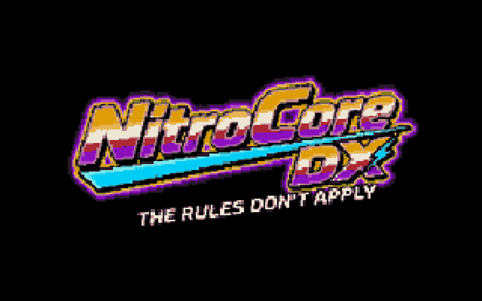
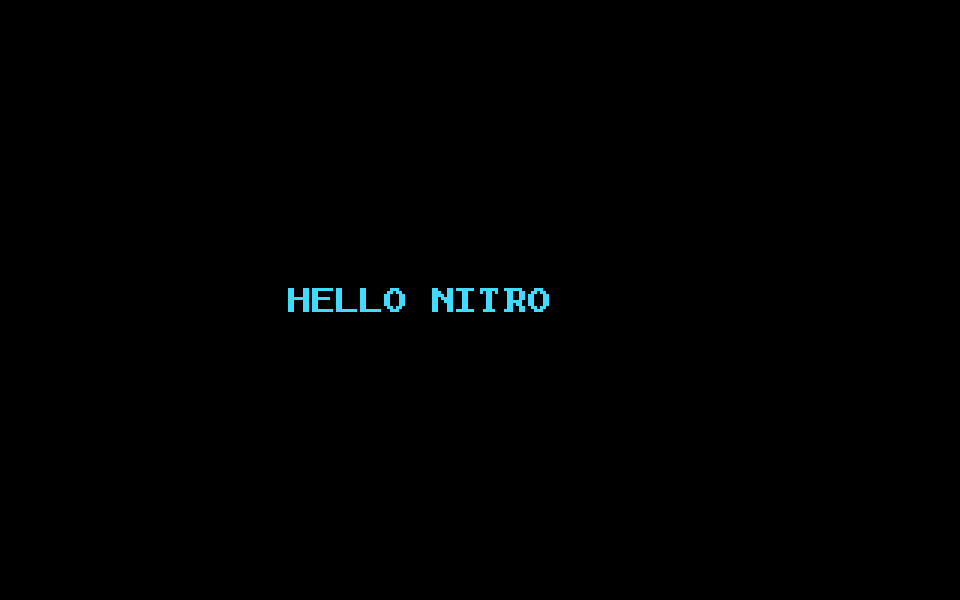
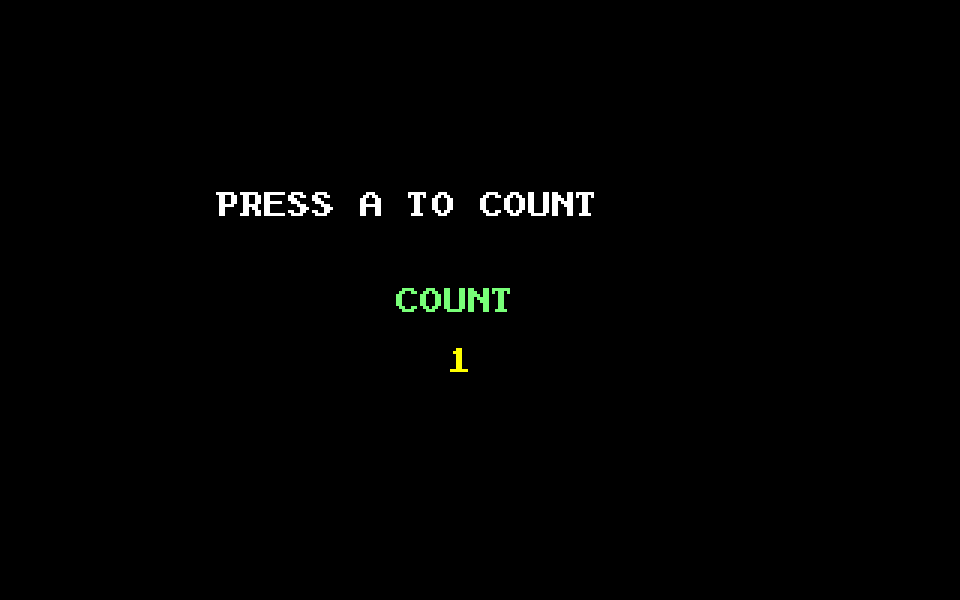
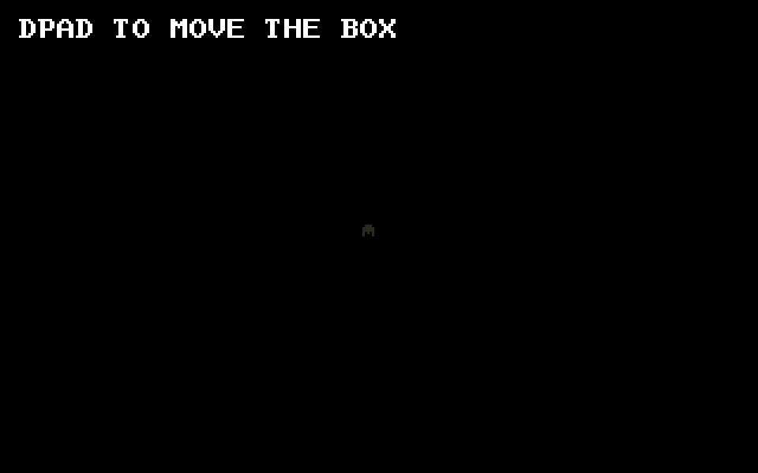
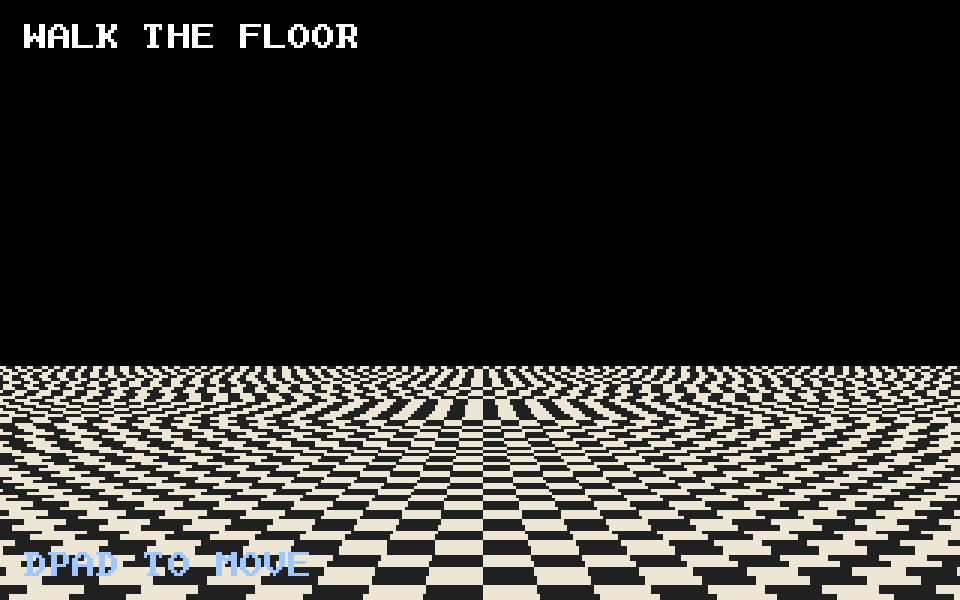
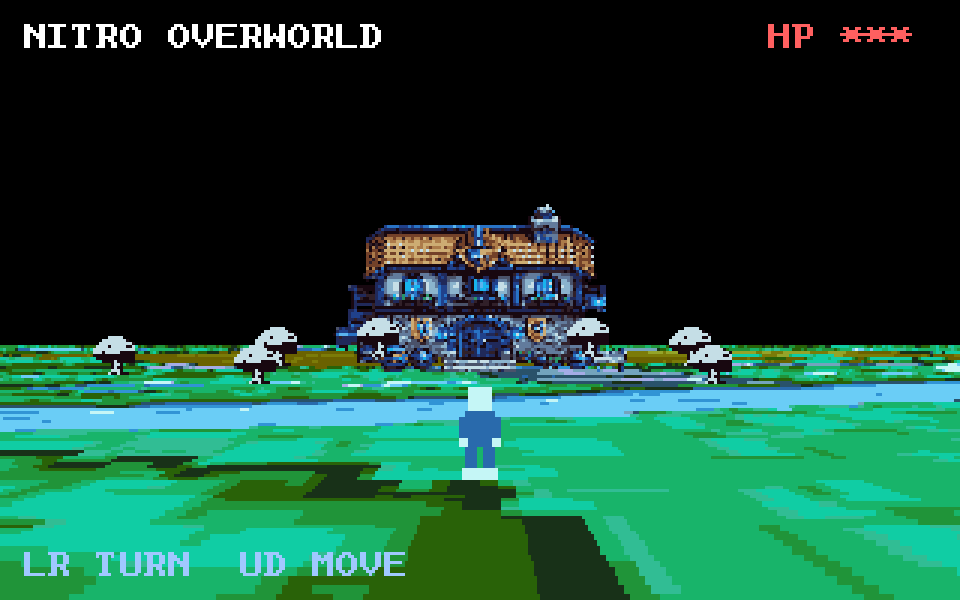

# The CoreLX Programming Manual

### Making games for Nitro-Core-DX

**A Retro Code Ramen publication for Nitro-Core-DX.**
Written by AJ / Retro Code Ramen. Your guide through the machine is Fletcher,
who is not the author, does not want the paperwork that comes with being the
author, and would like that noted up front.

> **This is the programming book.** It is CoreLX: the language, the builtins,
> the cartridges, and how Sprite Lab, Tilemap Lab, and Sound Studio land
> their work in your source. How to run the console, how the hardware is
> laid out, and how to use the Dev Kit itself live in the
> [Nitro-Core-DX Manual](NITRO_CORE_DX_MANUAL.md).

> **Status: living manual.** Sections appear here only after the feature they
> describe is implemented and verified running on the Nitro-Core-DX core — so
> nothing in this guide is a promise. It already works, or it isn't in here
> yet. Every demo program in this book is compiled and run against the real
> emulator core by the test suite (`internal/corelx/manual_examples_test.go`);
> if one ever stops working, the build breaks. If something in this manual and
> the code disagree, trust the code and tests first.

---

## Table of Contents

**Getting Started**
1. [Two Ways to Program Nitro-Core-DX](#two-ways-to-program-nitro-core-dx)
2. [CoreLX Quick Start](#corelx-quick-start)

**Part 1 — The CoreLX Language**
3. [Two Kinds of Numbers, and Why One of Them Lies to You](#chapter-1--two-kinds-of-numbers-and-why-one-of-them-lies-to-you)
4. [Constants: Naming Things So You Stop Lying to Yourself](#chapter-2--constants-naming-things-so-you-stop-lying-to-yourself)
5. [Globals, and the Map of Where Everything Lives](#chapter-3--globals-and-the-map-of-where-everything-lives)
6. [Arrays: When You Need a Row of the Same Thing](#chapter-4--arrays-when-you-need-a-row-of-the-same-thing)
7. [Loops That Count: `for i = 0 to N`](#chapter-5--loops-that-count-for-i--0-to-n)
8. [Conditions](#chapter-6--conditions)
9. [Structs: Beyond `Sprite()`](#chapter-7--structs-beyond-sprite) (includes [Functions That Return Values](#functions-that-return-values))
10. [Putting Words on the Screen](#chapter-8--putting-words-on-the-screen)
11. [Reading the Controller](#chapter-9--reading-the-controller)
12. [The Game Loop: Frames, VBlank, and `wait_vblank()`](#chapter-10--the-game-loop-frames-vblank-and-wait_vblank)
13. [Modules: Sharing Code With `--!`](#chapter-11--modules-sharing-code-with---)
14. [Sprites and OAM](#chapter-12--sprites-and-oam)
15. [Matrix Planes: Floors and Billboards](#chapter-13--matrix-planes-floors-and-billboards)
16. [Audio: Music and Sound Effects](#chapter-14--audio-music-and-sound-effects)
17. [Assets, Studios, and the `.ncdx` Project Format](#chapter-15--assets-studios-and-the-ncdx-project-format)

**Part 2 — Building a Game**
18. [The Demo Programs](#the-demo-programs)
19. [What's Next](#whats-next)

**Part 3 — Tools and Reference**
20. [Build and Run Workflows](#build-and-run-workflows)
21. [Assembly (Advanced Users)](#assembly-advanced-users)
22. [CoreLX vs. Assembly: When to Use Which](#corelx-vs-assembly-when-to-use-which)
23. [Troubleshooting Guide](#troubleshooting-guide)
24. [What Is Planned](#what-is-planned)
25. [Reference Links](#reference-links)
26. [Final Advice](#final-advice)

---

## A Short Word Before Fletcher Takes Over

CoreLX is the language you use to make the Nitro-Core-DX do things. Not a
general-purpose language you later bend toward a console — a language shaped
around *this* machine: its 16-bit registers, its WRAM, its very specific
opinions about numbers. You will learn it by building real programs and then
breaking them on purpose, because that is the fastest way to understand any
machine that has ever existed.

Fletcher will handle the rest. He has been here longer than the documentation.

---

## Two Ways to Program Nitro-Core-DX

### 1. CoreLX (Recommended for Most Projects)

CoreLX is the main language for game and app development:

- indentation-based syntax
- hardware-oriented built-ins (`ppu.*`, `gfx.*`, `sprite.*`, `oam.*`,
  `input.*`, `bg.*`, `matrix.*`, `matrix_plane.*`, `music.*`, `mem.*`)
- compiles directly to machine-code ROMs
- integrated into the Nitro-Core-DX app's `Build` / `Build + Run` flow

### 2. Assembly (Advanced / Low-Level)

A real v1 text assembler (`.asm` -> `.rom`) exists for advanced users. Use it
when you want exact instruction-level behavior, hardware bring-up tests, or to
learn the CPU and machine model directly.

> **Important:** CoreLX and Assembly are currently **separate build paths**.
> Inline mixed-mode `asm { ... }` inside CoreLX is not implemented yet.

The Dev Kit (menus, labs, Build + Run, the debugger pane) is covered in
the [Nitro-Core-DX Manual](NITRO_CORE_DX_MANUAL.md). This book starts at
the language.

---

## CoreLX Quick Start

### Your Entry Point: `Start()`

Every normal CoreLX program begins with:

```corelx
function Start()
    -- your game/app code here
```

Before `Start()` runs, the compiler always shows the Nitro-Core-DX boot logo —
a brief slide-in-and-hold splash — unless your program defines its own
`__Boot()` function to take over the entry point (see Chapter 10 for when and
why you'd do that; most programs never need to).



### Smallest Useful Program

```corelx
function Start()
    ppu.enable_display()

    while true
        wait_vblank()
```

This turns on display output and waits forever.

### Run it

Open the Dev Kit. That is the program: **File → Open Project…** the
`.corelx`, then **Build + Run**. The game screen in that window plays
the boot logo, then your program. You are not typing a launch command
for each run.

A cartridge you have already built opens in the player the same way.
Start the emulator and use **File → Open ROM…** on the `.cart` or
`.rom`. Passing `-rom` is optional, for when a script is launching it.

### From a terminal

Compiling a cartridge file, when you want the file itself:

```bash
go run ./cmd/corelx hello.corelx hello.cart
go run ./cmd/emulator
```

The second command opens the player. **File → Open ROM…** and choose
`hello.cart`.

> **Fletcher:** You don't pick banks yourself. Early on, the compiler could
> only fit your code into a single 32KB ROM bank — write enough functions and
> you'd hit a wall. That's gone now; the compiler spans your code across as
> many banks as the cartridge has. The cartridge still has a size. See "How
> Big Can My Game Get? ROM Banking" at the end of Chapter 15.

---

# Part 1 — The CoreLX Language

## Chapter 1 — Two Kinds of Numbers, and Why One of Them Lies to You

You write `3`. You write `3.6`. Looks like the same kind of thing, right? Two
numbers, one of them has a dot. On most machines you'd be correct and we could
all go home.

Not here.

> **Fletcher:** Sit down. The first thing that bites everybody on this board is
> numbers, and it bites them precisely *because* they assume numbers are
> boring. On the DX, the moment you put a dot in a number, you've changed what
> kind of number it is. Not how it prints. What it *is*. I have watched grown
> engineers lose an afternoon to this. We're going to lose ninety seconds
> instead.

CoreLX has two numeric types you'll touch constantly:

- **`int`** — a 16-bit signed whole number. Range −32768 to 32767. Every plain
  integer you write is an `int`: `3`, `1023`, `0x8010`.
- **`fixed`** — a fractional number stored in **8.8 fixed-point**. Eight bits
  for the whole part, eight for the fraction. And here is the part that trips
  people: **every decimal literal is a `fixed`.** Write `3.6`, `0.5`, `1.75`
  and you have written `fixed` values. The machine made that decision for you
  the instant you typed the dot.

`fixed` covers roughly −128.0 to +127.996, in steps of 1/256. That's your
fraction resolution: 1/256, about 0.004. Smaller than that and the DX shrugs.

Here is a small program that moves a number around. It compiles and runs:

```corelx
const SPEED = 3.6            -- has a dot, therefore fixed
const WORLD_MAX = 1023       -- no dot, therefore int

var x: fixed = 64.0
var lives: int = 3

function Start()
    x = x + SPEED            -- fixed plus fixed: the machine is content
    x = x * 0.5               -- fixed times fixed: also fine, full precision
    while true
        wait_vblank()
```

Nothing surprising yet. Now let's make it angry.

### Breaking it on purpose

You've got a speed in `fixed` and a counter in `int`. Naturally you try to
multiply them, because that's a completely reasonable thing a person would do:

```corelx
var speed: fixed = 1.5
var count: int = 3
out = speed * count          -- this does NOT compile
```

The compiler stops you cold:

```
cannot mix fixed and int operands in '*' — convert explicitly with int(x) or fixed(x)
```

The compiler reports every one of these it finds in a file, not just the
first, so fix them all in one pass.

> **Fletcher:** Good. That error is the machine doing you a favor, even though
> it doesn't feel like one. `fixed` and `int` store their bits completely
> differently — `1.5` in `fixed` is the bit pattern `0x0180`, not the number
> one-and-a-half sitting in a register being polite. If the compiler let you
> multiply them as if they were the same thing, you wouldn't get an error.
> You'd get a *wrong answer*, silently, three weeks from now, in a build you've
> already shown people. I would rather yell at you today.

### What went wrong, and how to say what you meant

You have to convert, out loud, in the direction you actually want:

```corelx
out = speed * fixed(count)   -- 1.5 * 3.0 = 4.5  (count promoted to fixed)
whole = int(speed) * count   -- 1 * 3 = 3        (speed chopped down to int)
```

`fixed(i)` turns an int into a fixed: `3` becomes `3.0`. `int(f)` rounds
toward more negative, so `4.5` becomes `4` and `-4.5` becomes `-5`. That is
not the same rule as `/`, which rounds toward zero. Two functions, both say
exactly which way the bits move.

> **Field Notes:** The DX has no floating-point unit. None. It was never going
> to. Floating-point hardware is expensive in gates and this is a console that
> wants those gates for making things move on screen. `fixed` is the old,
> honest trick: store the fraction as a plain integer count of 1/256ths and
> agree, as a civilization, where the decimal point lives. Every racing game's
> sense of speed on hardware like this was built on exactly this idea.

> **Raccoon Engineering:** `fixed / fixed` divides in 8.8 and rounds toward
> zero, same rule as `int / int`. `-1.5 / 0.5` is `-3.0`. The result is 16
> bits, so a quotient that does not fit wraps, the same way multiplication
> does. Dividing by a constant zero is a compile error. A divisor that is
> zero at runtime yields `0xFFFF`, which is what the hardware DIV instruction
> does.

> **Fletcher's Warning Label:** `/` and `%` are signed and round toward zero,
> on both `int` and `u16`. `u16` is a second name for a 16-bit `int`:
> comparisons, `>>`, and `/` are signed, so a value above 32767 does not
> behave like an unsigned quantity. A literal from 32768 through 65535 is
> still accepted: `var big: int = 40000` stores those bits, which compare as
> `-25536`, so `big > 0` is false. `70000` does not fit in 16 bits and is a
> compile error. `u8` is different — it really is one
> byte, and the next global starts at the next address. `-7 / 2` is `-3`,
> and `-7 % 2` is `-1` (the
> remainder keeps the dividend's sign). `>>` is an arithmetic shift: `-8 >> 1`
> is `-4`, not a giant unsigned number. `<<` stays a logical left shift.
> `%` is only defined for `int`. Constant expressions and runtime expressions
> use the same 16-bit results, so a `const` and a variable doing the same
> division agree.

### Try This Before You Panic

Make a `fixed` variable, set it to `0.1`, and add it to itself ten times.
Print the result or peek at it in the debugger. It will **not** be exactly
`1.0`, and that is not a bug — `0.1` isn't perfectly representable in 1/256
steps, so a tiny error rides along each time. This is the single most important
thing to feel in your hands early: `fixed` is precise, but it is not *infinite*.
Knowing where it rounds is the difference between a smooth game and a jittery
one.

---

## Chapter 2 — Constants: Naming Things So You Stop Lying to Yourself

Here's a number from a real program: `1023`. What is it? The right edge of the
world? A bitmask? The price of something? You wrote it last week and now you're
staring at it like it owes you money.

> **Fletcher:** Magic numbers are how code rots. Not dramatically — quietly. One
> day `1023` means the world edge, and six months later you change the world
> size, miss one of the eleven places you typed `1023`, and now your player can
> walk through a wall on the east side of the map only. I have debugged that
> exact bug. It took an hour. It should have taken zero, because the number
> should have had a *name*.

A `const` gives a value a name that's computed once, at compile time. It costs
you nothing at runtime — no memory, no slowdown. Every place you use it, the
value gets baked straight into the program.

```corelx
const BASE = 100
const DOUBLE = BASE * 2          -- constants can build on earlier ones
const FLAGS = 0x10 | 0x02        -- hex; 0b1010 is binary. 010 is ten, not octal
const HALF_SPEED = SPEED / 2.0   -- fixed constants work too: + - * /
```

Use them for everything that's a *fact* about your game: world bounds, zone
edges, speeds, hardware register values, the number of lives you start with.
If you're typing the same number twice, it wants to be a `const`.

### Breaking it on purpose

Try to change one:

```corelx
const LIMIT = 10
function Start()
    LIMIT = 5            -- nope
```

```
cannot assign to constant LIMIT
```

> **Fletcher:** Right, and that's the *point* of the word "constant," so I'm not
> going to pretend that's a surprise. But here's the genuinely useful part:
> because constants are resolved at compile time, the machine does the math
> *before the game ever runs*. `DOUBLE = BASE * 2` isn't a multiply on the
> console — by the time your cartridge boots, `DOUBLE` is just `200`, sitting
> there, already done. Free arithmetic. Use it shamelessly.

> **Field Notes:** `HALF_SPEED = SPEED / 2.0` is the same division the console
> does at runtime. A constant is just that division done once, on the
> workbench, and the console receives the finished number. The two agree,
> including the sign. Baking a table of headings is still worth it when you
> would otherwise repeat the same division every frame. Half of the pseudo-3D
> math in this guide's own demo game is built on exactly that trick.

### Try This Before You Panic

Take a program you've already got and hunt for every raw number that appears
more than once. Give each one a `const` with a name that says what it *is*, not
what it equals. `const WORLD_MAX = 1023`, not `const TEN_TWENTY_THREE = 1023`.
Future-you is the one you're writing these names for.

---

## Chapter 3 — Globals, and the Map of Where Everything Lives

You've got a score. The title screen needs it, the gameplay needs it, the
game-over screen needs it. It has to live somewhere every part of your program
can reach. That somewhere is a **global**, and it lives in WRAM — the
machine's working memory.

```corelx
var scene: int = 0           -- the compiler picks the address
var score: int               -- no initializer means it starts at 0
var energy: u8 = 255         -- u8: one byte, holds 0 to 255
var player_x: fixed = 64.0
```

A `var` at the top level — outside any function — is global. It exists for the
whole life of the game, and every function can see it. Initializers run once,
at power-on, before `Start()` does anything.

> **Fletcher:** On a lot of machines you'd be picking memory addresses by hand
> here, like an animal, writing `score` at `0x2100` and `lives` at `0x2102` and
> praying you never overlap two things. I did that for years. It is exactly as
> fun as it sounds. CoreLX does it for you now, and — this is the part I
> actually like — it writes down *where it put everything*.

### The map

The compiler allocates globals automatically, starting at WRAM address
`0x2100`. You never pick addresses, and you can never accidentally land two
variables on the same spot. And every time you build, it drops a **memory map**
file next to your ROM — `yourgame.rom.memmap` — listing every global, its
address, and its size. When you're knee-deep in the debugger at 2 a.m., that
file tells you exactly where `score` actually lives.

Three regions of WRAM are worth knowing:

| Region | Whose it is |
|---|---|
| `0x2000`–`0x20FF` | the compiler's own runtime scratch — **hands off** |
| `0x2100` upward | your globals, placed automatically |
| `0x7000`–`0x7FFF` | **yours, forever** — the compiler never touches it |

That last region matters. If you're doing something raw and clever with
`mem.*` pokes and you want memory the compiler will *never* step on, `0x7000`
to `0x7FFF` is your sandbox. Guaranteed.

### When you actually do need a specific address

Sometimes the hardware cares where something lives — a buffer you're going to
stream to a register, a table the DMA reads. You can pin a global to an exact
address:

```corelx
var dma_buffer at 0x7200: u8[96]
```

### Breaking it on purpose

Pin something somewhere stupid:

```corelx
var oops at 0x2080: int        -- inside the compiler's runtime block
```

```
global oops pinned at 0x2080 overlaps the reserved runtime block (0x2000-0x20FF)
```

> **Fletcher:** And it'll catch you the same way if you pin two things on top of
> each other, or drop a pin into the I/O registers up at `0x8000`. Pinning is a
> sharp tool. The compiler checks the blade before you grab it. Notice I pinned
> `dma_buffer` at `0x7200` — up in *your* region, not down in the auto-allocated
> pile where it'd collide with the variables the compiler is placing. Pin into
> your own sandbox, not someone else's workbench.

> **Tape Jam:** Variable not holding what you expect, and the value looks like
> garbage that *almost* makes sense? Before you blame your logic, open the
> `.memmap` file and confirm the address you're poking in the debugger is
> actually the variable you think it is. Half of all "impossible" memory bugs
> are just looking at the wrong address with great confidence.

### Try This Before You Panic

Build any program with two or three globals in it, then open the `.memmap`
file the compiler wrote. Read it. See `score` at `0x2100`, see the next one
sitting right after it. Get comfortable with that file now, while the stakes
are low — it becomes your best friend the first time something goes wrong in
memory, which it will.

---

## Chapter 4 — Arrays: When You Need a Row of the Same Thing

One score is a `var`. But sixty-four heading angles for a turning camera, or a
field of stars, or a row of tile values — those want to live together, in
order, reachable by number. That's an **array**.

```corelx
const N = 8
var table: int[N]
var palette_rows: u8[4]

function Start()
    i := 0
    while i < N
        table[i] = i * 10        -- any expression for the index
        i = i + 1
    total := table[3] + table[7] -- read them back by number
```

A `const` may be the length: with `N` equal to 8, `int[N]` is an eight-slot array. Arrays start zeroed — every slot is `0` until you put something there.
`int[n]` and `fixed[n]` use two bytes per slot; `u8[n]` uses one. They live in
WRAM right alongside your other globals, and they show up in the memory map.

You can also give an array its full contents up front, as a literal — this is
how you'd build a lookup table (Chapter 2's "precompute instead of divide"
trick, in practice):

```corelx
var doubles: int[5] = [0, 2, 4, 6, 8]
```

### Breaking it on purpose

Reach past the end:

```corelx
var table: int[4]
function Start()
    table[4] = 1            -- there is no slot 4; valid slots are 0,1,2,3
```

```
index 4 out of bounds for table[4]
```

> **Fletcher:** Caught at *compile time*, before the cartridge ever boots,
> because that index was a constant the compiler could check. That's the good
> case. Now, the honest part you need to hear: if your index is something the
> machine only figures out *while running* — a variable, a result of math — the
> DX does **not** check it for you. It can't afford to. This is a 16-bit
> console with frames to render; it is not going to spend cycles babysitting
> every array access. Write past the end with a runtime index and you'll
> happily stomp on whatever WRAM sits after your array, and the machine will
> let you, whistling.

> **Fletcher's Warning Label:** A constant index, like `table[4]`, gets checked
> when you build. A computed index, like `table[i]`, does **not** get checked
> when it runs. That's not laziness, it's the deal you make for speed on real
> hardware. Keep your loop bounds honest — `while i < N`, not `while i <= N` —
> and you'll never feel the missing seatbelt. Get the bound wrong and you'll
> feel it as the strangest bug of your week.

> **Raccoon Engineering:** A pre-computed table beats math every time on this
> machine. If your game keeps calculating the same handful of values —
> sines for a spin, speeds for each heading — compute them once into a `const`-
> sized array at startup (or bake the literal in directly, as above) and just
> *look them up* after that. The DX reads memory faster than it grinds
> arithmetic. Trade a little WRAM for a lot of frame time. That's the whole
> trick behind half the smooth-looking effects on hardware like this. The
> table can hold negative values, and so can a runtime `/` or `>>` — the
> lookup is about speed, not about the sign.

### Try This Before You Panic

Make an `int[8]`, fill it in a loop with `table[i] = i * i`, and read the
values back in the debugger using the address from your `.memmap` file. You'll
see `0, 1, 4, 9, 16, 25, 36, 49` laid out in WRAM, two bytes each. Now
deliberately change your loop to `while i <= 8` and watch it write one slot too
far. Find what it landed on in the memory map. That's the bug you're learning
to never ship.

### A note on local variables (you've been using them)

Inside a function, `:=` makes a local and figures out the type from what you
give it:

```corelx
x := 5          -- int (no dot)
speed := 2.5    -- fixed (dot)
x = x + 1       -- plain = changes something that already exists
```

The local takes the type of that expression. `x := speed` is `fixed` when
`speed` is `fixed`, and so is `x := -1.5`, `x := speed * 2.0`, `x := fixed(3)`,
a call that returns `fixed`, or a slot of a `fixed` array. A later `x + 0.5`
is then fixed plus fixed.

Three ways to make a name, and each one tells you that name's whole life at a
glance: `:=` is local to the block it is written in, `var` is a global in
WRAM, `const` is a compile-time fact with no storage at all. You'll never have
to wonder how long a name lives — you can see it in how it was born.

---

## Chapter 5 — Loops That Count: `for i = 0 to N`

You want to do something eight times. Fill eight table slots, draw eight stars,
check eight collision boxes. You *could* write it out eight times like you're
being paid by the line. You could also set up a `while` loop with a counter and
a manual increment and an off-by-one bug waiting to happen. Or you could just
say what you mean.

```corelx
for i = 0 to 7
    table[i] = i * 10
```

That runs with `i` equal to 0, 1, 2, 3, 4, 5, 6, 7. **Eight times.** The bounds
are *inclusive* — `0 to 7` means zero through seven, both ends, exactly like you
read it out loud.

> **Fletcher:** I want to stop you on that word "inclusive" because it is the
> single most common place people miscount. `for i = 0 to 7` runs eight times,
> not seven. If you've come from machines where the loop limit means "stop
> *before* this," unlearn that here. On the DX, `to 7` includes 7. Say the
> range out loud — "zero to seven" — and count on your fingers if you have to. I
> still do.

Need to count down, or skip? Add a `step`:

```corelx
for i = 10 to 0 step -2
    -- i is 10, 8, 6, 4, 2, 0  (six times)
```

### Breaking it on purpose

The `step` has to be a number the compiler knows when it builds — a constant,
not something computed while the game runs. Try to make it a variable:

```corelx
for i = 0 to 10 step my_var      -- nope
```

```
for loop 'step' must be a constant
```

> **Fletcher:** That's deliberate, and here's the why: the compiler needs to
> know which *direction* you're counting so it knows when to stop. Counting up,
> it stops when you pass the top. Counting down, it stops when you pass the
> bottom. If your step could secretly be positive *or* negative depending on
> some variable, the compiler can't pick the right finish line, and a loop with
> the wrong finish line either stops too early or runs until the heat death of
> your cartridge. So: `step` is a constant. Pick a direction at write-time.

> **Try This Before You Panic:** Loop `for i = 0 to 5` and in the body draw the
> counter on its own line: `text.draw_int(80, 40 + i * 12, 255, 255, 255, i)`.
> The `40 + i * 12` pushes each number twelve pixels lower than the last, so you
> get a column 0,1,2,3,4,5. Count the lines — there are six, not five. Now flip
> it to `for i = 5 to 0 step -1` and watch the column come out upside down.
> Feeling the inclusive bounds with your own eyes once beats me telling you ten
> times. (`text.draw_int` is in Chapter 8 — it draws a number instead of a
> string.)

---

## Chapter 6 — Conditions

You've already seen `if` used bare. It also takes an `else`:

```corelx
if x < 10
    x = x + 1
else
    x = 0
```

Real games need more than two ways — a scene variable that's title, or
playing, or game-over. Chain them with `else if`. The first true condition
runs, and the rest of the chain is skipped:

```corelx
if scene == SCENE_TITLE
    x = 1
else if scene == SCENE_PLAYING
    x = 2
else if scene == SCENE_GAMEOVER
    x = 3
else
    x = 0
```

`elseif` is the same clause written as one word. `else` on its own line, with
a nested `if` indented under it, is still a normal else body. That nested `if`
is not a chain: it runs only when the outer condition was false, then follows
ordinary `if` rules from there.

Conditions overlap more often than they look. `n > 10` is also `n > 0`. Put
the narrower test first, or the later branch never gets a turn:

```corelx
if n > 30
    got = 3
else if n > 20
    got = 2
else if n > 10
    got = 1
else
    got = 0
```

A second `if` at the same indent is not part of the chain. It runs on its own,
even when an earlier branch already did.

Each `if` branch, `else`, `while` body, and `for` loop is its own block. A
name made there does not exist after the block, so both branches may use
`tmp`:

```corelx
if ready
    tmp := 1
else
    tmp := 2
```

Those are two different variables. Declaring `tmp` twice in the *same* block
is still an error. A `for` variable exists for that loop and not after it.

`and` and `or` always evaluate both sides. `if ready and reload()` calls
`reload` even when `ready` is false. There is no short-circuit.

### `break` and `continue`

Inside a `while` or `for` loop, `break` exits the loop immediately, and
`continue` skips the rest of the current iteration and moves on to the next
one. In a `for` loop, the loop variable still advances when you `continue` —
it never skips that part.

```corelx
-- Sums 0..9, skipping 5 and stopping dead at 8:
--   0+1+2+3+4+6+7 = 23
for i = 0 to 9
    if i == 5
        continue          -- skip just this iteration
    if i == 8
        break              -- stop the loop entirely
    total = total + i
```

That's `break_continue.corelx` from the demo programs (Part 2) — run it and
watch the HUD confirm `23`, not `45` (what you'd get if you never skipped or
stopped at all) and not `28` (what you'd get if `break` fired where `continue`
should have).

> **Why This Matters:** Most game code is just "read input -> update variables
> -> draw state" repeated every frame. Conditions decide *what* updates; loops
> decide *how many times*. Getting both exactly right, including their sharp
> edges, is most of what separates code that works from code that almost does.

---

## Chapter 7 — Structs: Beyond `Sprite()`

### Functions That Return Values

Every function you've written so far has been void — it does things, but it
doesn't hand anything back. CoreLX functions can return a value too, with a
`-> type` after the parameter list and a `return` statement in the body:

```corelx
function double(n: int) -> int
    return n * 2

function Start()
    x := double(21)
    -- x is 42
```

`return` on its own (no expression) works too, as an early exit from a void
function — useful for "bail out of the rest of this function" guard clauses:

```corelx
function heal(p: Player, amount: int)
    if p.lives <= 0
        return          -- already dead, nothing to heal
    p.lives = p.lives + amount
```

`return`'s value travels back in the same single slot every numeric value
travels in, so it works for `int`, `fixed`, and `bool` — anything that fits in
one 16-bit register. It does *not* work for handing back a whole struct by
value; a struct is a reference (see below), so a function that needs to give
you struct data back either mutates a struct you passed in (like `damage()`
below) or writes into a global you read afterward, the same pattern the demo
programs use for HUD values.

You've seen `Sprite()` already if you've looked ahead at any sprite code — it's
a built-in struct CoreLX gives you for OAM sprite records. But you aren't
limited to it. Declare your own with `struct Name:` followed by an indented
list of `field: type` lines:

```corelx
struct Player:
    x: int
    y: int
    lives: int
```

`Player()` creates one, and you read/write its fields with `.`:

```corelx
hero := Player()
hero.x = 100
hero.y = 50
hero.lives = 3
```

### Structs are reference types

Pass a struct to a function and the function shares the *same* struct — its
edits are visible to the caller when the function returns. There's no `&`, no
pointers, because CoreLX has no unary address-of operator at all; you never
write `&hero`, you just pass `hero`:

```corelx
function damage(p: Player)
    p.lives = p.lives - 1

function Start()
    hero := Player()
    hero.lives = 3
    damage(hero)
    damage(hero)
    -- hero.lives is now 1, not 3 -- damage() shared the same struct
```

Function parameters need an explicit type — `function damage(p: Player)`, not
`function damage(p)` — the same way `var`/`asset` declarations do.

A struct can also live in WRAM as a global, and you can have a row of them.
A field can itself be a struct. The global starts at zero; assign the fields:

```corelx
type Vec = struct
    x: int
    y: int

type Body = struct
    pos: Vec
    hp: int

var hero: Player
var enemies: Player[8]
var body: Body

function Start()
    hero.x = 100
    enemies[0].lives = 3
    body.pos.x = 4
```

A local array is a block of slots that starts at zero. Pass the name to a
function and the function sees the same slots:

```corelx
function bump(xs: int[4])
    xs[1] = xs[1] + 1

function Start()
    xs: int[4]
    xs[1] = 3
    bump(xs)
```

The length is part of the type. `int[4]` and `int[8]` are not the same
argument. A local array has no `= [...]` initializer — that form is for
globals (Chapter 4); fill a local array in code.

> **Fletcher's Warning Label:** A function can take at most **six**
> parameters. That's not an arbitrary nicety — two of the machine's eight
> registers (R6/R7) are permanently reserved as scratch space for the
> cross-bank calls described earlier, so only six are ever free for arguments.
> If you find yourself reaching for a seventh, it's usually a sign the
> function wants a struct instead of a fistful of loose values.

> **Fletcher:** If you've used a language with real pointers, "reference type,
> no address-of operator" might look like a contradiction. It isn't — it just
> means the *only* way to hand a struct to something is to hand over the real
> thing, never a copy and never a raw address you could get clever with. You
> can't accidentally alias two unrelated structs by messing up a pointer,
> because there's no pointer to mess up. You also can't do certain low-level
> tricks people do with pointers on other machines. For a 16-bit console
> that's a trade I'll take every time — most of those tricks are exactly the
> kind of thing that turns into a 2 a.m. debugging session.

See `structs.corelx` in the demo programs (Part 2) for the full, verified
version of this example, including how to check a struct field's value from
outside the program (a local struct doesn't get a fixed WRAM address the way a
`var` global does, so the demo mirrors `hero.lives` out to a small global
before entering its main loop — the same thing you'd do to feed a value to a
HUD anyway).

---

## Chapter 8 — Putting Words on the Screen

Your game runs. Brilliant. But it's a black void, and the only person who knows
anything is happening is you, squinting at a debugger. Time to put something on
the glass. Start with text, because text is how you say `SCORE`, `GAME OVER`,
and `PRESS START` — the words every game needs.

```corelx
text.draw(40, 80, 255, 255, 255, "HELLO NITRO")
```

Six arguments: X, Y, then **three separate color numbers** — red, green, blue,
each 0 to 255 — and finally the string. So `255, 255, 255` is white, `255, 0, 0`
is red, and so on. The text appears at pixel (40, 80) and marches to the right,
eight pixels per character. A call may break across lines inside the
parentheses; indentation there is ignored. A newline *outside* the
parentheses still ends the statement.

> **Fletcher:** I know what you're about to ask. "Why three color numbers?
> Every other system lets me pass one color." Because the DX's text port has
> three separate eight-bit channels — red, green, blue — sitting at three
> separate hardware addresses, and a single number on this machine is sixteen
> bits. Sixteen bits cannot hold three eight-bit channels. The math doesn't
> fit. So instead of lying to you with a fake "color" that secretly loses
> information, CoreLX hands the port exactly what it wants: R, G, B, each on its
> own. It's one more number to type and zero surprises later. I'll take that
> trade every day.

> **Field Notes:** When you write a string, the characters stream out to a
> single hardware register one at a time, and the port quietly advances the
> cursor eight pixels after each one. That's why your text flows left to right
> without you tracking position — the *port* is keeping the cursor, not you.

`docs/manual_examples/hello.corelx` draws `HELLO NITRO` in cyan this way,
every frame:



### Breaking it on purpose

Strings are special on the DX. They're **labels**, not a data type you can
store and shuffle around. Try to put one in a variable:

```corelx
var name: int = 0
name = "PLAYER"          -- the compiler stops you
```

```
strings can only be used directly as a text.draw argument in v1
```

> **Fletcher:** Right, and before you grumble — this is a 16-bit console, not a
> word processor. v1 strings exist to *label things on screen*: scores, menus,
> the word "PAUSED." They are not a place to store the player's name and do
> clever text manipulation. For now: a string goes straight into `text.draw`,
> full stop.

### Numbers on the screen

A string is a fixed label. But a *score* changes — it's a number that lives in a
variable and goes up. For that, there's a second function:

```corelx
var score: int = 0

function Start()
    score = 1230
    while true
        wait_vblank()
        text.draw(120, 80, 255, 255, 255, "SCORE")
        text.draw_int(140, 100, 255, 255, 0, score)
```

`text.draw_int` takes the same first five arguments as `text.draw` — X, Y, and
the three color channels — but the last argument is a **number**, not a string.
It prints it as digits: `1230` shows up as `1230`. Negatives get a minus sign,
and leading zeros are dropped, so `42` prints as `42`, not `00042`.

`counter.corelx` is that on a real screen. One press of A, and the yellow
digit is 1. Holding A does not keep counting.



> **Tape Jam:** Text not showing up? Two usual culprits. One: you drew it once,
> at startup, but the screen clears every frame and your text only lived for
> that first frame — draw it *every* frame, inside your loop, if you want it to
> stay. Two: you drew it at a coordinate off the edge of the 320×200 screen,
> where it is rendering perfectly into the void.

---

## Chapter 9 — Reading the Controller

A game nobody can control is a screensaver. Let's read the pad. On the DX the
pattern is always the same three beats: **poll once per frame, then ask
questions.**

```corelx
function Start()
    while true
        wait_vblank()
        input.poll()                 -- read the controller, once, up top
        if input.held(LEFT)
            -- move left while LEFT is down
        if input.pressed(A)
            -- fire ONCE, the instant A goes down
```

`input.poll()` reads the controller hardware and remembers it. Then:

- `input.held(BUTTON)` is true *while* the button is down — for movement, where
  you want continuous action.
- `input.pressed(BUTTON)` is true only on the **single frame** the button goes
  from up to down — for actions you want to happen *once* per press: firing,
  jumping, confirming a menu.
- `input.released(BUTTON)` is the opposite edge — true the frame a button comes
  back up.

The buttons have names you just use: `UP DOWN LEFT RIGHT A B X Y L R START Z`.
Those twelve names are reserved. `const A`, `var X`, and `Z := 1` are errors,
and the message says the name is a controller button. Pick another identifier.

> **Low-Level Escape Hatch:** `input.read() -> int` bypasses all of the above
> and reads the raw 16-bit controller-1 button bitmask straight from the
> hardware port, with no `held`/`pressed`/`released` edge-tracking at all —
> you get whatever's currently down, as a bitmask, full stop. You won't need
> this for ordinary gameplay code (`input.poll()` + `held`/`pressed`/
> `released` covers everything above), but it's there if you're writing a
> button-mapping screen or want to inspect the raw hardware state directly.

> **Fletcher:** The difference between `held` and `pressed` is the thing that
> separates a game that feels right from one that feels broken, so let me make
> it stick. Use `held` for walking: you hold left, you keep walking left, frame
> after frame. Use `pressed` for firing: you press A, *one* shot comes out, and
> you don't get another until you let go and press again. If you wire your fire
> button to `held` by mistake, the player taps A once and unloads forty bullets
> in two-thirds of a second because the button was "down" for forty frames.
> I have shipped that bug. The playtesters called it "the machine gun glitch."
> It was not a feature.

> **Field Notes:** `input.pressed` has to know what the button was doing *last*
> frame to spot the edge. CoreLX remembers that for you in a corner of memory it
> owns and you never see — but only correctly if you `poll()` exactly once per
> frame, at the top of your loop. Poll twice and you'll smear two reads
> together; forget to poll and you're reading a stale frame. Once per frame, up
> top. Make it a habit you don't think about.

### Breaking it on purpose

Wire a fire button to the wrong question:

```corelx
input.poll()
if input.held(A)
    spawn_bullet()      -- a bullet EVERY frame A is down: the machine gun glitch
```

Hold A for one comfortable second and you've spawned sixty bullets. The fix is
one word — `held` becomes `pressed` — and now it's one bullet per press, the way
a person expects.

> **Raccoon Engineering:** You can build a "tap to start, hold to fast-forward"
> control out of these two cheaply: `pressed` triggers the first action
> immediately, and `held` (maybe gated behind a frame counter — Chapter 10)
> takes over if they keep the button down. Menus that advance once on tap but
> scroll when held are built on exactly this pair.

> **Try This Before You Panic:** Make a global `var count: int = 0`. In your
> loop, `poll()`, then `if input.pressed(A)` add one to `count`, and draw it
> with `text.draw_int`. Mash A and watch it climb by exactly one per press. Now
> change `pressed` to `held` and hold A — watch it rocket upward. That runaway
> number *is* the machine gun glitch, and now you'll recognize it on sight.
> (This is `counter.corelx` in the demo programs — a complete, working version
> is waiting for you.)

---

## Chapter 10 — The Game Loop: Frames, VBlank, and `wait_vblank()`

Every CoreLX program you've seen so far ends in the same shape:

```corelx
while true
    wait_vblank()
    -- read input, update state, draw
```

`wait_vblank()` pauses your program until the next VBlank — the brief window
between video frames where it's safe to update what's about to be drawn.
Calling it once per loop is what makes your game run at one update per real
video frame, instead of running as fast as the CPU possibly can (which would
make your game speed depend on how fast the machine happens to be, not on
anything you control).

### Breaking it on purpose

Here's the part that isn't obvious: VBlank isn't an instant, it's a *window* —
the flag that says "we're in VBlank" stays set for a whole scanline's worth of
time, not just one tick. That means a loop like this:

```corelx
while true
    wait_vblank()
    x = x + 1
```

can, under the wrong conditions, run its body **more than once** for the same
real video frame — `wait_vblank()` returns immediately again if VBlank is still
active, before the next real frame has actually started. Held-input logic
(walking, turning) isn't self-correcting the way `input.pressed` edge-detection
is, so if this fires twice in one real frame, your player moves twice as fast
as you intended, unpredictably, depending on exact timing.

> **Fletcher:** This one's sneaky because it doesn't happen every frame, and it
> doesn't happen the same amount every time it does happen — which makes it
> look like "sometimes movement feels floaty" rather than a specific,
> nameable bug. It's the same root cause every time, though: your loop body ran
> twice for one frame's worth of real time.

### The fix: a frame-counter debounce

Every per-frame loop body in this guide's demo game uses this exact pattern:

```corelx
var last_frame: int = 0

function Start()
    last_frame = frame_counter()
    while true
        while frame_counter() == last_frame
            wait_vblank()
        last_frame = frame_counter()
        -- now this runs exactly once per real video frame
```

`frame_counter()` is a running count of real video frames that have elapsed.
The inner `while` loop keeps calling `wait_vblank()` until the frame counter
has actually ticked forward — so no matter how many times VBlank's flag lets
`wait_vblank()` return inside one real frame, your loop body below it only
ever runs once per frame. This is the same pattern the music player and the
demo game's movement code both use.

> **Fletcher's Warning Label:** You don't need this debounce for a program
> that's *only* drawing static text or reading `input.pressed` (edge-triggered
> input is naturally safe against running twice — a press either happened or
> it didn't). You need it the moment you're accumulating state every frame:
> position from `input.held`, a counter, an animation timer. If your movement
> "feels too fast" or "sometimes jumps," check this before you check anything
> else.

### Before `Start()`: `__Boot()` and the Splash Screen

Every compiled program shows the Nitro-Core-DX boot logo — a brief slide-in
and hold — before `Start()` ever runs. That happens because the compiler
quietly injects a default `__Boot()` function that calls
`boot.show_default()` (the stock slide+hold sequence) and then calls
`Start()`. You never see this unless you go looking for it.

You can take over the entry point yourself by defining your own `__Boot()`:

```corelx
function __Boot()
    input.poll()
    if input.held(A)
        secret_mode = 1
    Start()
```

Defining `__Boot()` replaces the default entirely — the stock splash will
**not** show unless you call it yourself. If you still want the stock
presentation before doing your own thing, call `boot.show_default()` as the
first line of your own `__Boot()`:

```corelx
function __Boot()
    boot.show_default()   -- stock slide+hold, then continue
    input.poll()
    if input.held(A)
        secret_mode = 1
    Start()
```

> **Watch Out:** A custom `__Boot()` runs *before* `Start()`'s own setup —
> `wait_vblank()`/`input.poll()` work identically there, but nothing you set
> up in `Start()` exists yet. Most programs never need a custom `__Boot()` at
> all; it exists for the rare case where you want to read input or make a
> decision before the game's normal setup even begins.

---

## Chapter 11 — Modules: Sharing Code With `--!`

`--!` lines are directives, not comments — they're only legal at the very top
of the file, before any code, and declare things about the file itself:

```corelx
--! corelx 1.0
--! modules: anim, sfx
```

- `--! corelx <version>` records which CoreLX version the file targets.
- `--! modules: name, name, ...` pulls in one or more modules — plain
  `.corelx` files that live in a `modules/` folder next to your project.
  Functions inside a module are called the same way as builtins, namespaced
  by the module's name.

A module is just a normal CoreLX file — functions, and any `const`/`var`
declarations those functions need — nothing special about its own syntax. If a
named module isn't found in the `modules/` folder, you get a clear error
(`module 'name' not installed`) rather than a confusing "unknown function" at
the call site. An unrecognized directive is also a compile error, not a
silently-ignored line.

Two modules ship with the project today:

### The `anim` Module (Sprite Animation)

`anim` (`modules/anim.corelx`) handles the two genuinely reusable parts of
sprite animation: frame timing and mirroring. Frame lists themselves stay as
plain array constants in your own code — a module can only index arrays
declared in the same file:

```corelx
--! modules: anim

const WALK_FRAME_COUNT = 4
var walk_frames: int[4] = [1, 2, 3, 4]

function Start()
    hero := Sprite()
    while true
        wait_vblank()
        idx := anim.frame_index(WALK_FRAME_COUNT, 8)  -- new frame every 8 ticks
        hero.tile = walk_frames[idx]
        anim.set_mirror(hero, 0)                      -- 1 to flip horizontally
```

`anim.frame_index(frame_count, ticks_per_frame)` returns which frame (0 to
`frame_count - 1`) should be showing right now, looping back to 0 after the
last one. `anim.set_mirror(sprite, mirror)` sets or clears horizontal flip —
useful for getting a second direction (e.g. "walk right") out of frames you
only drew once (e.g. "walk left"). See `anim_module.corelx` in the demo
programs for the complete, verified version.

### The `sfx` Module (Sound Effect Triggers)

`sfx` (`modules/sfx.corelx`) wraps a free FM channel's key-on/key-off for
quick one-shot sound effects:

```corelx
--! modules: sfx

function Start()
    while true
        wait_vblank()
        input.poll()
        if input.pressed(A)
            sfx.play(0)   -- key-on channel 0
```

> **Watch Out:** `sfx` deliberately does not set pitch or instrument — it's a
> key-on/key-off convenience wrapper only. Set those up through the low-level
> `ym.write` register path (Chapter 14) before triggering the effect, or wait
> for a future pass that gives `sfx` a real pitch/instrument argument.

---

## Chapter 12 — Sprites and OAM

A sprite is a small, independently-positioned image the PPU can move around
without redrawing the background underneath it — the classic "one moving
object" primitive every 2D console has had since the beginning. CoreLX gives
you a built-in `Sprite()` struct shaped exactly like one OAM (Object
Attribute Memory) record.

```corelx
box := Sprite()
sprite.set_pos(box, 152, 92)
box.tile = tile_base
box.attr = SPR_PAL(1) | SPR_PRI(0)
box.ctrl = SPR_ENABLE() | SPR_SIZE_16()

oam.write(0, box)
oam.flush()
```

- `sprite.set_pos(sprite, x, y)` sets screen position.
- `.tile` is the base tile index (from `gfx.load_tiles`, Chapter 15).
- `.attr` packs palette, priority, and flip bits — build it from the helper
  functions below, combined with `|`.
- `.ctrl` packs enable and size bits, same idea.
- `oam.write(index, sprite)` copies the struct's fields into OAM slot `index`
  and writes straight through to the PPU — there's no separate commit step.
- `oam.flush()` exists but currently does nothing (a no-op reserved for a
  future write-buffering scheme). It's harmless to call and harmless to skip
  — the example above keeps it only because it costs nothing and won't hurt
  if a future version gives it real behavior.

`sprite.corelx` is one 8×8 sprite. The line at the top is `text.draw`.
The box in the middle is the sprite.



Just like every other struct (Chapter 7), pass `box` itself — never `&box`.
CoreLX has no address-of operator, and `Sprite()` is no exception to that.

### Sprite Helper Functions

- `SPR_PAL(n)` — sprite palette select bits
- `SPR_PRI(n)` — sprite priority bits (0-3; see the note below)
- `SPR_ENABLE()` — enable bit
- `SPR_SIZE_8()` / `SPR_SIZE_16()` — 8x8 or 16x16 sprite
- `SPR_SIZE_32X16()` / `SPR_SIZE_32X32()` / `SPR_SIZE_64X32()` /
  `SPR_SIZE_64X64()` / `SPR_SIZE_128X64()` / `SPR_SIZE_128X128()` — larger
  sprite sizes, up to 128x128 (see "Bigger Sprites" below)
- `SPR_HFLIP()` / `SPR_VFLIP()` — horizontal/vertical flip
- `SPR_BLEND(mode)` / `SPR_ALPHA(a)` — blend mode and alpha bits

### Bigger Sprites

A single sprite isn't stuck at 16x16 — the hardware supports eight sizes in
total, up to 128x128, built internally from a grid of 8x8 tiles (a 32x32
sprite is a 4x4 grid, 128x128 is 16x16, and so on). Above 16x16, only the
tiles you've actually loaded show anything — an unloaded grid cell reads as
transparent, so you don't have to fill a full 128x128 image just to use a
big sprite; a smaller shape inside a bigger bounding box (for hit-testing
against, say) works fine too.

> **Fletcher's Warning Label:** These larger sizes need TWO bits that don't
> fit in `.ctrl` (an 8-bit field) — so unlike `SPR_SIZE_8()`/`SPR_SIZE_16()`,
> you can't just write `box.ctrl = SPR_ENABLE() | SPR_SIZE_32X32()` and have
> it work. Use `sprite.set_size(box, SPR_SIZE_32X32())` instead — a
> dedicated call that writes the size where it actually needs to go. For
> `oam.write_sprite_data`, the `ctrl` argument handles this correctly on its
> own; no separate call needed there.

```corelx
big := Sprite()
big.tile = tile_base
big.attr = SPR_PAL(1) | SPR_PRI(0)
sprite.set_size(big, SPR_SIZE_32X32())
big.ctrl = SPR_ENABLE()
sprite.set_pos(big, 100, 80)
oam.write(0, big)
oam.flush()
```

`sprite.set_pos` and `sprite.set_size` can be called in either order — each
preserves whatever the other one already wrote.

> **Why This Matters — Priority:** Sprites and background layers (Chapter 13)
> share one compositing order, sorted by priority (`SPR_PRI(n)` for sprites,
> `bg.set_priority(layer, n)` for backgrounds) — whichever has the *higher*
> number is drawn *later*, which means it ends up on top. If your sprite
> vanishes behind a background layer you were sure was "behind" it, check both
> priorities: a background left at a higher priority number than your sprite
> will paint right over it every frame.

### Moving It Around

Reading the controller (Chapter 9) and moving a sprite is the same `held` +
clamp pattern you've already seen for a camera:

```corelx
if input.held(RIGHT)
    box_x = box_x + SPEED
if box_x > 312
    box_x = 312
```

See `sprite.corelx` in the demo programs (Part 2) for the complete, verified
version — D-pad moves an 8x8 box around the screen, clamped so it never runs
off the edge.

### OAM Notes

- `oam.write(index, sprite)` writes one sprite record from a `Sprite()`
  variable.
- `oam.write_sprite_data(id, x, y, tile, attr, ctrl)` writes the same record
  from plain values instead, when you don't want to keep a `Sprite()` variable
  around.
- `sprite.set_size(sprite, size_flags)` sets one of the larger sizes (see
  "Bigger Sprites" above) on a `Sprite()` variable — needed because that
  size information doesn't fit in `.ctrl`.
- `oam.clear_sprite(id)` disables a sprite by zeroing its control byte.
- `oam.flush()` is currently a no-op — every `oam.*` write above already
  reaches the PPU immediately, with nothing further to commit. Calling it is
  optional today; it's kept as a real builtin in case a future version adds
  write-buffering that needs an explicit commit point.

---

## Chapter 13 — Matrix Planes: Floors and Billboards

Nitro-Core-DX has a dedicated matrix-plane model in the emulator/runtime,
separate from ordinary BG tilemap usage. This is the machinery behind the
pseudo-3D floor in `floor.corelx` (Part 2) and behind vertical "billboard"
objects — buildings, NPCs, anything that should stand upright on that floor
and scale correctly as you approach it.

This is `floor.corelx`, standing still at the opening camera. The
checkerboard is the matrix plane. The two lines of text are the HUD.



### Why This Exists

A BG tilemap layer is great for a flat, 2D scrolling background. It is not
built to answer "what does this floor look like from a moving, turning
camera, projected in perspective." Matrix planes exist specifically for that:
each matrix-capable layer can bind to a transform channel that sources from
its own tilemap memory, pattern memory, *or* a dedicated bitmap, and can drive
a generic per-plane projection (flat/affine, perspective floor, or vertical
billboard) instead of a plain scroll.

### Current Matrix Plane Capabilities

- Plane sizes: 32x32, 64x64, 128x128 (in 8x8 or 16x16 tiles)
- Source modes: tilemap/pattern-backed, or bitmap-backed (for large imported
  images that don't fit the tile-backed plane's 256-tile index ceiling)
- Projection modes: `0` none/manual rows, `1` perspective row projection
  (the floor), `2` vertical projected quad (a billboard)
- Outside-plane behavior: wrap, backdrop color, tile 0, or clamp

### The Recommended High-Level Path

```corelx
matrix_plane.set_projection(channel, mode, horizon)   -- mode: 0 none, 1 perspective rows, 2 vertical quad
matrix_plane.set_depth(channel, base_distance, focal_length, width_scale)
matrix_plane.set_camera(channel, x, y, heading_x, heading_y)
matrix_plane.set_surface(channel, origin_x, origin_y, facing_x, facing_y)  -- vertical quads only
```

Vertical projected quads are treated as real world-space planes, not
screen-facing billboards in the Doom sense: the renderer intersects the camera
ray with the plane defined by `ORIGIN_*`/`FACING_*`, the bottom of the quad is
anchored to the ground position `ORIGIN_*` represents, and off-angle views
narrow and foreshorten realistically instead of always facing the camera.

### Pitfall: Every Plane In A Scene Must Share One Camera-Eye

If a scene combines a perspective floor with one or more vertical-billboard
planes (a building, an NPC, any object standing "on" that floor), every one of
those planes' `matrix_plane.set_camera(channel, x, y, heading_x, heading_y)`
calls must be fed the **exact same** `x, y` position for a given frame — not
just the same *player* position, but the same fully-computed camera-eye
position, including any camera trick layered on top of it.

This bit a real demo directly. A common technique for a walking-around game is
a "feet pivot": instead of rendering the floor from the player's raw position,
the floor's camera trails the player by a fixed world-unit offset in the
direction opposite of facing —

```corelx
eye_x = cam_x - pivot_x[heading_index]
eye_y = cam_y - pivot_y[heading_index]
matrix_plane.set_camera(0, eye_x, eye_y, heading_x[heading_index], heading_y[heading_index])
```

— so that turning visually pivots around the character's own feet/screen
position instead of around the floor's raw coordinate. The mistake is
assuming a billboard object (a building, say) should track the player's *raw*
position instead, on the reasoning that "the billboard should scale off the
real player position, not some camera trick." That reasoning sounds
principled, but it's wrong: it silently makes the billboard render from a
**different eye position than the floor**, and since the pivot offset itself
rotates with heading, the mismatch between the two eyes also rotates —
visually, the billboard appears to drift/slip across the floor as the camera
turns, even though the object's own world position never changed. It looks
exactly like a physics bug (the building "isn't anchored to the ground
right"), but the actual cause is a camera inconsistency between planes, not
anything wrong with the billboard's own placement math.

**The fix**: compute the camera-eye position once per frame, and pass that
same value to `matrix_plane.set_camera` for every plane in the scene that's
meant to share one coherent 3D space — the floor, every billboard standing on
it, and, if applicable, the audio/gameplay logic that also cares about "where
the camera is." Never let one plane use a raw position while a sibling plane
in the same scene uses an adjusted one, even if the adjustment seems purely
cosmetic (like a feet-pivot offset). If you have multiple independent scenes
(say, an outdoor overworld and an interior room), each scene needs its own
consistently-shared eye — don't mix eyes from different scenes either.

```corelx
-- WRONG: billboard uses a different eye than the floor it stands on.
matrix_plane.set_camera(0, cam_x - pivot_x[h], cam_y - pivot_y[h], heading_x[h], heading_y[h])
matrix_plane.set_camera(1, cam_x, cam_y, heading_x[h], heading_y[h])

-- RIGHT: compute the eye once, feed it to every plane in the scene.
eye_x = cam_x - pivot_x[h]
eye_y = cam_y - pivot_y[h]
matrix_plane.set_camera(0, eye_x, eye_y, heading_x[h], heading_y[h])
matrix_plane.set_camera(1, eye_x, eye_y, heading_x[h], heading_y[h])
```

If you actually *want* an object to visually behave differently from the
floor (e.g. a HUD-anchored object that should never move relative to the
screen), that's a real design choice — but it means the object isn't meant to
occupy the same 3D space as the floor at all, and shouldn't be using
`matrix_plane.set_camera`'s world-position semantics for it.

### Low-Level MMIO Programming Path

If you are writing low-level ROM code, the dedicated matrix-plane aperture is:

- `0x8080` `MATRIX_PLANE_SELECT` — selects plane `0-3`
- `0x8081` `MATRIX_PLANE_CONTROL` — bit 0 enable; bits [2:1] size (`0`=32x32,
  `1`=64x64, `2`=128x128); bit 3 source mode (`0`=tilemap/pattern,
  `1`=bitmap); bits [7:4] bitmap palette bank
- `0x8082`/`0x8083` `MATRIX_PLANE_ADDR_L/H` — tilemap upload address
- `0x8084` `MATRIX_PLANE_DATA` — writes one tilemap byte, auto-increments
- `0x8085`/`0x8086` `MATRIX_PLANE_PATTERN_ADDR_L/H`
- `0x8087` `MATRIX_PLANE_PATTERN_DATA` — writes one pattern byte, auto-increments
- `0x8088`-`0x808A` `MATRIX_PLANE_BITMAP_ADDR_L/M/H`
- `0x808B` `MATRIX_PLANE_BITMAP_DATA` — writes one bitmap byte, auto-increments
- `0x808C` `MATRIX_PLANE_FLAGS` — bit 0 palette-index-0-is-transparent, bit 1
  visible from both sides
- `0x808D` `MATRIX_PLANE_ROW_CONTROL` — bit 0 row mode enabled
- `0x808E`/`0x808F` `MATRIX_PLANE_ROW_ADDR_L/H`
- `0x8090` `MATRIX_PLANE_ROW_DATA` — writes one row-parameter byte
- `0x8091` `MATRIX_PLANE_PROJECTION_CONTROL`
- `0x8092` `MATRIX_PLANE_HORIZON`
- `0x8093`-`0x8096` `MATRIX_PLANE_CAMERA_X/Y_L/H`
- `0x8097`-`0x809A` `MATRIX_PLANE_HEADING_X/Y_L/H` (8.8 fixed forward vector)
- `0x809B`/`0x809C` `MATRIX_PLANE_BASE_DISTANCE_L/H`
- `0x809D`/`0x809E` `MATRIX_PLANE_FOCAL_LENGTH_L/H`
- `0x809F`/`0x80A0` `MATRIX_PLANE_WIDTH_SCALE_L/H`
- `0x80A1`-`0x80A4` `MATRIX_PLANE_ORIGIN_X/Y_L/H` (vertical quads)
- `0x80A5`-`0x80A8` `MATRIX_PLANE_FACING_X/Y_L/H` (8.8 fixed, vertical quads)
- `0x80A9`/`0x80AA` `MATRIX_PLANE_HEIGHT_SCALE_L/H`

#### Row Table Layout

Each visible scanline has a 16-byte row record: bytes 0-3 `StartX`, 4-7
`StartY`, 8-11 `StepX`, 12-15 `StepY`. There are 200 visible scanlines, so one
plane's row table is 3200 bytes.

#### Typical Upload Sequence

1. select the matrix plane
2. configure its size and enable bit
3. choose source type
4. if tile-backed: upload tilemap bytes (`0x8082-0x8084`), then pattern bytes
   (`0x8085-0x8087`)
5. if bitmap-backed: upload bitmap bytes (`0x8088-0x808B`)
6. if row-driven: upload row parameters (`0x808E-0x8090`)
7. bind a visible layer to that transform channel, and enable matrix mode on
   that channel

```text
write8(0x8080, 0)      ; plane 0
write8(0x8081, 0x05)   ; enable + 128x128

write8(0x8082, 0x00)
write8(0x8083, 0x00)
for each tilemap byte
    write8(0x8084, byte)

write8(0x8085, 0x00)
write8(0x8086, 0x00)
for each pattern byte
    write8(0x8087, byte)
```

Bitmap-backed upload:

```text
write8(0x8080, 0)      ; plane 0
write8(0x8081, 0x1D)   ; enable + 128x128 + bitmap source + palette bank 1

write8(0x8088, 0x00)
write8(0x8089, 0x00)
write8(0x808A, 0x00)
for each packed bitmap byte
    write8(0x808B, byte)
```

Row-mode upload:

```text
write8(0x8080, 0)      ; plane 0
write8(0x808D, 0x01)   ; row mode enabled

write8(0x808E, 0x00)
write8(0x808F, 0x00)
for each row-table byte
    write8(0x8090, byte)
```

#### Pattern Memory Format

Same packed 4bpp tile format as normal tile data: `8x8` tile = 32 bytes,
`16x16` tile = 128 bytes. The layer's tile-size setting still controls how the
matrix renderer interprets the pattern data — if BG0 is `8x8`, your dedicated
matrix plane patterns must be authored as `8x8` tiles too.

#### Bitmap Plane Memory Format

Packed indexed 4bpp pixels: two pixels per byte, high nibble = even pixel,
low nibble = odd pixel, palette bank from `MATRIX_PLANE_CONTROL[7:4]`.
Bitmap-backed planes are the direct validation path for large imported images
that don't fit cleanly into the tile-backed plane's 256-tile index ceiling.

#### Tilemap Entry Format

Each tilemap entry is byte 0 = tile index, byte 1 = attributes (palette low
bits + flip bits).

#### Outside Behavior

The transform channel's matrix-control register defines outside behavior: `0`
= wrap (classic repeating floor), `1` = backdrop, `2` = tile 0, `3` = clamp
(hold the edge instead of repeating).

### Practical Advice

- Use dedicated matrix planes for large rotated/scaled backgrounds; keep
  ordinary BG tilemaps for conventional HUD/background work.
- Start with `128x128 @ 8x8` when you want a true `1024x1024` source plane.
- **The plane's canvas size should match your world's coordinate range 1:1.**
  A bitmap import stretches the source image to fill the *entire* plane
  canvas rather than padding it — if your plane is smaller than the range
  your camera actually walks over, the texture will visibly tile/repeat well
  before you reach the edges of your intended world.
- Don't hand-pack tilemap/pattern uploads unless you're explicitly doing
  low-level hardware work — use the high-level path above.

---

## Chapter 14 — Audio: Music and Sound Effects

Nitro-Core-DX's audio subsystem is the **YM2608 / OPNA** chip (FM, SSG,
rhythm, ADPCM), driven through a hardware/MMIO host interface at
`0x9100-0x91FF`. CoreLX's `music.*` built-ins are the real, primary,
emulator-tested way to play music from a CoreLX program.

### The `music.*` Built-ins (Song Playback)

A music asset is a compiled `.ncdxmusic` stream (built with
`cmd/vgm_to_ncdxmusic`, or written directly) declared like any other asset:

```corelx
asset Theme: music "theme.ncdxmusic"
asset Fanfare: music "fanfare.ncdxmusic"

function Start()
    music.play_loop(Theme)
    while true
        wait_vblank()
```

- `music.play(asset)` plays once and stops (silences the chip and clears
  playback state when the song ends).
- `music.play_loop(asset)` plays and wraps back to the start forever.
- `music.play_jingle(asset)` stashes whatever's currently playing (including
  "nothing"), plays the given song once, then restores exactly what was
  playing before — frame index and all, not restarted from the top. Use it
  for a one-off sting (level-clear fanfare, item pickup) over a looping BGM
  track.
- `music.stop()` silences the chip immediately and clears playback state.
- `music.set_volume(level)` sets output volume (0-255) immediately.
- `music.fade_to(level, frames)` ramps volume to `level` over `frames` real
  frames — call it once, the ramp runs on its own each `wait_vblank()`.

All of these drive off `wait_vblank()` (Chapter 10) — the per-frame advance
only happens when your code calls `wait_vblank()`, the same place every other
per-frame system (input, animation) already expects to run.

### Sound Effects: The `sfx` Module

For one-shot sound effects triggered by gameplay events (a hit, a pickup, a
jump), use the `sfx` module (Chapter 11) rather than `music.*` — it's built
for quick key-on/key-off triggers on a free FM channel, not full song
playback. Remember it doesn't set pitch/instrument on its own yet; wire that
up through the low-level `ym.write` register path first if your effect needs
a specific tone.

### Low-Level FM Access

Advanced FM sound design — instrument definition, pitch, per-voice register
tweaking — is done through `ym.write`/`ym.write_port1` (the low-level YM2608
register escape hatch) or raw ROM code against the `0x9100-0x91FF` host
registers directly, until a higher-level CoreLX instrument API exists.

### Legacy `apu.*` Built-ins (Being Phased Out)

CoreLX still exposes an older 4-channel synth (`apu.enable`,
`apu.set_channel_wave/freq/volume`, `apu.note_on/off`) from before the YM2608
migration. **Treat these as legacy** — they target a different, non-final
synth and exist only so old code keeps compiling. New programs should use
`music.*` and `sfx`/`ym.*` instead.

---

## Chapter 15 — Assets, Studios, and the `.ncdx` Project Format

The Dev Kit's Sprite Lab, Tilemap Lab, and Sound Studio are the usual way
to make the art and music that this chapter talks about. How to *operate*
those tabs (menus, tools, hotkeys) is in the
[Nitro-Core-DX Manual](NITRO_CORE_DX_MANUAL.md). This chapter is the
contract: what they write into your source, what the compiler will accept,
and how a game is a `.ncdx` on disk.

### Why your art isn't *in* your code

You write code as text. You'd think a picture could be text too — and it can,
technically — but a single floor image is over a hundred thousand characters of
hex. Paste that into your `main.corelx` and you'd scroll past a wall of
gibberish for ten minutes to find your `while` loop. So we don't.

Instead, each image is its own file — a **`.cxasset`** — sitting next to your
code inside the project. You make one by running an image through the
importer, which converts your PNG into the DX's format once:

```
corelx_import  park.png  ParkFloor  32  1  park_floor.cxasset
```

Then in code you just *name* it and use it (the same line Sprite Lab and
Sound Studio write for you):

```corelx
asset ParkFloor: image "park_floor.cxasset"

function Start()
    matrix_plane.load_bitmap(ParkFloor, 0)
    ...
```

> **Fletcher's Warning Label:** The compiler is strict about the project and the
> code agreeing, in *both* directions, and it will refuse to build if they
> don't. Reference a `.cxasset` that isn't in the project? Error. Leave a
> `.cxasset` in the project that no code uses? Also an error — a "you forgot to
> wire this up, or you forgot to delete it" error. No mystery files, no dead
> weight.

### What Sprite Lab Writes

Sprite Lab lives on the **Sprite Lab** tab of the Dev Kit. When you are
happy with a drawing, three buttons put it into the project. They all
produce the same *kind* of CoreLX, they just land it in different places:

- **Insert Source Snippet** appends an `asset Name: tiles8` / `tiles16` /
  `tileset hex` block at the end of the file, plus optional
  `gfx.set_palette(...)` calls for the bank you were painting in.
- **Apply Source Asset** finds an existing `asset` of that name and
  rewrites it in place, or appends one if it isn't there yet. Palette
  writes are marked `-- Sprite Lab palette bank N` so a later apply
  can replace them without eating your other palette code.
- **Apply Manifest Asset** writes or updates `corelx.assets.json` next
  to the saved `.corelx` file, with `encoding: "hex"` and a type of
  `tiles8`, `tiles16`, or `tileset` based on the canvas size. The
  compiler merges that file with in-source `asset` declarations on
  every Build. A name that appears in both is `E_ASSET_DUPLICATE`.

The type rule is mechanical: an 8×8 canvas is `tiles8`, 16×16 is
`tiles16`, anything else (24×24 default, 32, 40, …, 64) is a `tileset`.
The hex is packed 4bpp, the same form as a hand-written `tileset` in
this chapter. **Export .clxsprite** / **Import .clxsprite** round-trip
the pixels and palettes as JSON (`clxsprite-v1`) so you can keep a
drawing without putting it in the ROM yet.

### What Tilemap Lab Writes

Tilemap Lab is the **Tilemap** tab. Maps are 8×8 to 32×32, step of 8
(default 32). Each cell is a packed `(tile, attr)` word: tile index in
the low byte, palette in the high nibble of the high byte, Flip X at
`0x10`, Flip Y at `0x20`. **Refresh Tiles From Code** parses
`tiles8` / `tileset` / `sprite` hex assets already in the file so you
can paint from them.

- **Insert CoreLX Asset** appends `asset Name: tilemap hex`.
- **Apply To Project** upserts that named block in the source.
- **Apply To Manifest** writes `type: "tilemap"` into
  `corelx.assets.json`.

**Export .clxtilemap** / **Import .clxtilemap** are the JSON
round-trip (`clxtilemap-v1`).

### What Sound Studio Writes

Sound Studio is the **Sound** tab. **Import VGM** takes a `.vgm` or
`.vgz` and converts it in memory to a `.ncdxmusic` stream. **Open
.ncdxmusic** loads one you already have. **Add to project** (the
source file must already be saved) writes `<Name>.ncdxmusic` next to
the `.corelx` and upserts:

```corelx
asset Name: music "Name.ncdxmusic"
```

**Preview** compiles a tiny ROM around that stream and loads it in the
embedded emulator so you can hear it. The INSERT snippets on the tab
are the `music.play` / `music.play_loop` / `music.play_jingle` /
`music.stop` / `music.set_volume` / `music.fade_to` calls from
Chapter 14, dropped at the cursor.

There is no separate "export music file" button: **Add to project**
*is* the export. Manifest apply is not wired for music yet; the
`asset … music "…"` line in source is the contract.

### Tile Assets (Inline)

Small assets can be written directly inline as hex, right in your source. Each
hex byte is **one pixel** — a palette index from 0 to 15 (0 is always
transparent for sprites) — not a packed byte. `tiles8` is one 8x8 tile (64
pixel values, 8 per line, 8 lines); `tiles16` is one 16x16 tile (256 values,
16 per line, 16 lines):

```corelx
asset BoxTile: tiles16
    hex
        00 00 00 00 00 00 00 00 00 00 00 00 00 00 00 00
        00 00 02 02 02 02 02 02 02 02 02 02 02 02 00 00
        00 02 02 02 02 02 02 02 02 02 02 02 02 02 02 00
        ...
```

The compiler packs this "one byte per pixel" form into the hardware's real
4bpp format for you (two adjacent pixels combined into one byte, high nibble
first) — you never write packed bytes by hand. `tiles8`/`tiles16` recognize
raw data by its length (exactly 64 or 256 values means "unpacked, needs
packing"); a `tileset`/`sprite` asset (used for native sprite sizes above
16x16 — see Chapter 12's "Bigger Sprites") can hold any number of tiles, so
length alone can't tell raw from packed, and the compiler instead checks
whether every byte is ≤15 (real packed data routinely has a byte >15, since a
packed byte's high nibble holds a whole second pixel's index).

> **Fletcher's Warning Label:** A `tileset`/`sprite` asset holding more than
> one 8x8 tile is **not** laid out as one flat image raster (row 0 of the
> whole picture, then row 1, and so on) — it's laid out **tile by tile**: all
> 64 pixels of the first 8x8 tile (its own 8 rows of 8), then all 64 pixels of
> the second tile, in left-to-right/top-to-bottom tile order. If you're
> converting art by hand instead of using the devkit's importer, slice your
> image into 8x8 blocks first, then write each block's own 8 rows in order —
> writing the image's own raw rows straight across a multi-tile asset scrambles
> it into an unrecognizable mess of interleaved tiles.

Supported encodings today: `hex` (most common, used throughout this guide and
its tests), `b64`, and `text`. Assets are referenced in code via a generated
constant: `ASSET_BoxTile`.

### Setting Colors: Palettes

Tile pixel values are palette *indices*, not colors — something has to say
what color index 2 actually looks like. `gfx.init_default_palettes()` fills
in a reasonable built-in set (used throughout this guide's examples) so you
can get moving without thinking about color hardware at all. When you want a
specific color:

- `gfx.set_palette(palette, color_index, color)` sets one color slot: palette
  bank 0-15, color index 0-15 within that bank, and a 16-bit RGB555 color
  value (5 bits each for red/green/blue, packed `0bRRRRRGGGGGBBBBB`).
- `gfx.set_palette_color(cgram_index, color)` does the same write, but
  addresses the color hardware's flat 0-255 index directly (`palette*16 +
  color_index`) instead of the two separate components — useful when you're
  computing an index rather than picking a literal palette/color pair.

Both write straight to the color hardware (CGRAM); there's no separate
"apply" step.

### What a Game Actually Is on Disk

A whole game is a single file: **`MyGame.ncdx`**. Look at it in your file
browser and you see one icon, one file. That's deliberate — a game should
be one thing you can hand to a friend, not a folder of loose pieces to
lose track of. The compiler CLI (`go run ./cmd/corelx MyGame.ncdx
out.cart`) accepts a `.ncdx`, a project folder, or a loose
`main.corelx`. The Dev Kit's Open dialog currently takes a `.corelx`
source file (see the Nitro-Core-DX Manual); the `.ncdx` is still the
thing you ship.

> **Fletcher:** Here's the honest truth under the hood, because you'll want to
> know it the first time something goes weird: a `.ncdx` is a **zip file**
> wearing a different hat. Inside it there's your `main.corelx`, your image
> assets, and a little `project.toml` with the title and such. The Studio packs
> and unpacks it for you so you never think about it. But it's a zip. Remember
> that.

### Editing the Guts Like an Admin Boss

Ninety-nine times out of a hundred you never touch the zip. The compiler
and the Dev Kit pack and unpack it for you. But sometimes you need to get
in there:

1. Make a copy (always work on a copy when going in by hand).
2. Rename `MyGame.ncdx` → `MyGame.zip`.
3. Unzip it. There's your `main.corelx`, your `.cxasset` files, your
   `project.toml`.
4. Do your surgery.
5. Zip the *contents* back up (the files at the root of the zip, not a folder
   containing them — that trips people up).
6. Rename `.zip` → `.ncdx`.

> **Fletcher:** Mind the one rule that bites everyone: when you re-zip, the
> files go at the **top level** of the archive — `main.corelx` should be right
> there when you open the zip, not buried inside a `MyGame/` folder. The
> compiler looks for `main.corelx` at the root.

> **Raccoon Engineering:** Because a `.ncdx` is just a zip, every tool you
> already own works on it — git can store it, a script can rip an asset out of
> a hundred of them, a diff tool can show you what changed between two builds
> (work on the unzipped folders for that; zips diff badly).

### How Big Can My Game Get? ROM Banking

The DX's cartridge ROM isn't one flat block of memory — it's organized into
**32KB banks** (banks 1-125 are yours; bank 0 is WRAM/I/O, and 126-127 are
extended WRAM). Historically that mattered to you directly: your *compiled
code* — not your art, your code — had to fit inside a single 32KB bank, and
once a project grew past that, the compiler would simply refuse to build it.

That ceiling is gone. The compiler now spans your code across as many banks
as it needs, automatically, and there is nothing in the language for you to
write to opt into it — it just happens. This section explains what's actually
going on, because "it just happens" is a lot less confusing once you've seen
the machinery once.

**The three-pass compile.** Every build tries the cheap path first:
1. **Compact pass.** Your whole program compiles into one bank, using
   ordinary same-bank `CALL`s (2 words each) — this is faster to run and
   produces a smaller ROM, so it's always tried first. If it fits, that's
   your ROM. This is still exactly what happens for small-to-medium
   projects, byte for byte the same as before banking existed.
2. **Measure pass.** If the compact pass overflows 32KB, the compiler
   recompiles once in "wide-call" mode: every function call — yours and the
   compiler's own internal helpers — is sized as a **far call** (5 words: two
   register loads for the target bank/offset, then the call itself), because
   that's the only kind of call that can safely cross a bank boundary. This
   pass exists purely to measure how big each of your functions actually is
   under that scheme.
3. **Bank-packing + final pass.** Using those measurements, the compiler
   walks your functions **in the order they're declared** (with `Start()` /
   `__Boot()` always first, since the hardware's boot vector requires your
   entry point to live in bank 1) and greedily fills each 32KB bank until the
   next function wouldn't fit, then starts a new one. It then does one more
   full compile against that bank assignment, producing your final ROM. Your
   image and music assets are placed immediately above wherever your code
   banks end.

**What fits on the cartridge.** Banks 1 through 125 are the whole cartridge.
Each of those banks has a 64KB address window, and only the upper 32KB
(`0x8000`–`0xFFFF`) is connected to ROM. The lower half is unmapped. Banks
126 and 127 are extra working memory, not ROM. The amount you can ship is
therefore 125 × 32KB = **4,096,000 bytes**. The `.rom` file is that payload
plus a 32-byte header, so a full cartridge file is 4,096,032 bytes.

Compiled code, images, and music all come out of that same 4,096,000 bytes.
Assets are written into the banks immediately after the code. The compiler
refuses bank 126 and beyond because the CPU will not read ROM there. CoreLX
does not impose a smaller cap. A figure of 7.8MB counts the full 64KB window
of each bank, including the half that is not on the cartridge.

**What this means for you, practically:**
- **You don't write anything differently.** No bank keyword, no `--!`
  directive, no pragma. A ten-line program and a ten-thousand-line program
  are written the same way.
- **The one real, visible consequence: a function can take at most six
  parameters**, not eight — see the warning label in Chapter 7. Two registers
  are permanently reserved as scratch space for far-call targets, whether or
  not your particular program ends up needing more than one bank.
- **A program that needs more than one bank pays a small, constant cost**:
  every call becomes 5 words instead of 2, and there's a couple of extra
  register loads before each call. At 60 frames a second this is not
  something you'll ever notice in ordinary game logic — it would only matter
  in an extremely tight, latency-critical inner loop, which isn't a thing
  CoreLX games typically need.
- **Locals are a separate budget, and they are not cartridge space.** Every
  function owns a fixed slice of WRAM for its variables, packed to the bytes
  it actually uses, between `0x0100` and the call stack. The compiler rejects
  a function that calls itself, or two functions that call each other, because
  that slice is one slot, not a stack frame that grows per call. You can keep
  writing functions until those locals, added
  together, fill that region. Filling it does not shrink the 4,096,000-byte
  ROM.
- **How to tell if your build spilled into a second bank**: there's no
  dedicated report for it yet, but the crude signal works fine — a
  single-bank `.cart`/`.rom` is 32KB plus the 32-byte header; once your
  compiled output is larger than that, you're multi-bank.

> **Fletcher:** I mention the measure-then-pack mechanics not because you'll
> ever touch them, but because the day you *do* care — chasing down a weird
> timing difference, reading a disassembly, wondering why your ROM got
> bigger after adding one small function — you'll want to know a whole
> extra compile pass happened quietly in between, and that where a function
> physically lands depends on *declaration order*, not call order or
> importance. Move a rarely-used function earlier in the file and it can
> shift which bank several other functions land in too.

---

# Part 2 — Building a Game

Everything in Part 1 is a piece. This part is where the pieces become a game —
following one real project, built feature by feature, each one landing here
only once it's actually built and verified running on the emulator.

## The Demo Programs

These aren't sketches — they live in `docs/manual_examples/`, and the test
suite compiles and runs every one of them against the real emulator on every
build. If a demo here ever stopped working, the build would break.

### `hello.corelx` — words on the glass

The smallest complete program that shows you something. Build + Run,
and after the boot logo you get cyan `HELLO NITRO` near the middle of
the screen.


```corelx
function Start()
    while true
        wait_vblank()
        text.draw(96, 96, 64, 220, 255, "HELLO NITRO")
```

Notice the text is drawn *inside* the loop — draw it once outside and it
flashes for a single frame and vanishes, because the screen clears every frame
(Chapter 8's Tape Jam, made real).

### `counter.corelx` — a number that counts

Press A, the number goes up by one. Hold A, it *still* only goes up by one,
because `input.pressed` fires on the press, not every frame (Chapter 9). This
is the machine-gun-glitch lesson turned into a thing you can hold. The
picture is one press later.


```corelx
var count: int = 0

function Start()
    while true
        wait_vblank()
        input.poll()
        if input.pressed(A)
            count = count + 1
        text.draw(72, 64, 255, 255, 255, "PRESS A TO COUNT")
        text.draw(132, 96, 120, 255, 120, "COUNT")
        text.draw_int(150, 116, 255, 255, 0, count)
```

### `sprite.corelx` — a sprite you can move

The Sprite()/OAM workflow from Chapter 12, made concrete: an 8x8 box you drive
with the D-pad, clamped to the screen.


```corelx
const SPEED = 2
var box_x: int = 152
var box_y: int = 92

function Start()
    gfx.init_default_palettes()
    tile_base := gfx.load_tiles(ASSET_BoxTile, 8)

    box := Sprite()
    box.tile = tile_base
    box.attr = SPR_PAL(1)
    box.ctrl = SPR_ENABLE() | SPR_SIZE_8()

    ppu.enable_display()

    while true
        wait_vblank()
        input.poll()
        if input.held(RIGHT)
            box_x = box_x + SPEED
        -- (full clamp logic in docs/manual_examples/sprite.corelx)
        sprite.set_pos(box, box_x, box_y)
        oam.write(0, box)
        oam.flush()
```

### `structs.corelx` — your own struct

Chapter 7's `Player` struct, made concrete, including the reference-type
sharing behavior across a function call.

### `break_continue.corelx` — skip one, stop dead

Chapter 6's `break`/`continue` sum, made concrete: `23`, not `45` or `28`.

### `anim_module.corelx` — the `anim` module

Chapter 11's `anim.frame_index` example, made concrete and running.

### `floor.corelx` — walk the floor

The big one: a pseudo-3D floor that rushes toward you as you drive the D-pad.
It pulls together a tile asset, matrix-plane setup, the projection and camera
builtins, global state, `input.held` movement, signed clamping to keep you
inside the world, and a HUD.


```corelx
asset Floor: tiles8 hex
    11 11 22 22 11 11 22 22
    11 11 22 22 11 11 22 22
    22 22 11 11 22 22 11 11
    22 22 11 11 22 22 11 11
    11 11 22 22 11 11 22 22
    11 11 22 22 11 11 22 22
    22 22 11 11 22 22 11 11
    22 22 11 11 22 22 11 11

const MOVE = 6
var cam_x: int = 512
var cam_y: int = 768

function Start()
    gfx.init_default_palettes()
    bg.enable(0)
    bg.bind_transform(0, 0)
    bg.set_priority(0, 2)
    matrix.enable(0)
    matrix.identity(0)
    matrix.set_center(0, 160, 100)
    matrix_plane.enable(0, 128)
    matrix_plane.load_tiles(ASSET_Floor, 0, 0)
    matrix_plane.clear(0, 0, 0)
    matrix_plane.set_projection(0, 1, 113)
    matrix_plane.set_depth(0, 0x0C00, 0xC000, 0x00C0)
    ppu.enable_display()

    while true
        wait_vblank()
        input.poll()
        if input.held(UP)
            cam_y = cam_y - MOVE
        -- (full input/clamp logic in docs/manual_examples/floor.corelx)
        matrix_plane.set_camera(0, cam_x, cam_y, 0, 256)
        text.draw(8, 8, 255, 255, 255, "WALK THE FLOOR")
        text.draw(8, 184, 160, 200, 255, "DPAD TO MOVE")
```

> **Fletcher:** Read that last one top to bottom and notice there's nothing in
> it you haven't already met. Setup happens once, before the loop. The loop runs
> forever: wait for the frame, read the pad, move, *clamp so you can't walk off
> the edge of the world*, push the camera to the plane, draw the HUD. That
> shape — setup, then `while true` of poll/update/draw — is the skeleton under
> every game on this machine. Learn that rhythm and the rest is just filling in
> what happens in the middle.

## What's Next

This part grows as the real demo game grows. The current build (see
`Games/NitroPackInDemo/`) already goes well beyond these small teaching
demos — a full overworld with a walkable pseudo-3D floor, a building you can
enter, an interior scene, an NPC with dialogue, and a credits screen.



Each new system that lands there (enemies, combat, a health bar, an
inventory, background music and sound effects) gets its own chapter here once
it's built and verified, the same way every chapter above did.

---

# Part 3 — Tools and Reference

## Build and Run Workflows

### Workflow A: Dev Kit (Recommended)

Covered in full in the [Nitro-Core-DX Manual](NITRO_CORE_DX_MANUAL.md).
The short version: File → New Project or Open Project…, then **Build +
Run**. Open takes a `.corelx` (also `.clx` / `.txt`); **Load ROM** takes
a `.rom`. The compiler CLI below is what you use for a `.ncdx` or a
project folder.

### Workflow B: CoreLX CLI

```bash
go run ./cmd/corelx mygame.corelx mygame.cart
```

Open the player and choose that file with **File → Open ROM…**, or
hand it straight to the window:

```bash
go run ./cmd/emulator -rom mygame.cart
```

The first argument may also be a `.ncdx` project file or a project folder.
The output is written under whatever name you give it; the tool's usage line
says `.cart` and the shipped demos use `.cart`, while this manual says `.rom`.
They are the same file, and the memory map lands beside it with `.memmap`
appended (`mygame.rom.memmap`, `overworld.cart.memmap`).

### Workflow C: Assembly CLI

```bash
go run ./cmd/asm mygame.asm mygame.rom
```

Then open it with the Dev Kit's **Load ROM**, or with the player's
**File → Open ROM…**.

---

## Assembly (Advanced Users)

### Current Status (v1 Assembler)

- text `.asm` input -> `.rom` output ✅
- labels ✅
- branches/jumps/calls ✅
- full current CPU opcode coverage ✅
- simple directives (`.entry`, `.word`) ✅

### What Assembly Is Good For Right Now

- hardware tests
- timing experiments
- low-level demos
- FM MMIO experiments before higher-level CoreLX audio APIs cover them
- debugging compiler output assumptions

### Assembly Syntax (v1)

**Registers:** `R0` to `R7`

**Immediate values** — prefix with `#`:

```asm
MOV R0, #1
MOV R1, #0x8008
MOV R2, #$FF
```

**Memory access** — use `[Rn]`:

```asm
MOV R0, [R1]      ; 16-bit load (MMIO-safe for IO because CPU handles IO reads as 8-bit zero-extended)
MOV [R1], R0      ; 16-bit store (IO writes become low-byte writes)
MOV.B R2, [R1]    ; explicit 8-bit load
MOV.B [R1], R2    ; explicit 8-bit store
```

**Comments** — both styles accepted: `; comment` or `-- comment`.

**Labels:**

```asm
start:
    MOV R0, #0
loop:
    ADD R0, #1
    CMP R0, #10
    BLT loop
    RET
```

### Directives (v1)

- `.entry bank, offset` — set entry bank/offset (defaults: bank `1`, offset
  `0x8000`)
- `.word value` — emit one raw 16-bit word

### Supported Instructions (v1)

**Data/Memory:** `NOP` `MOV` `MOV.B` `PUSH` `POP`
**Arithmetic/Logic:** `ADD` `SUB` `MUL` `DIV` `AND` `OR` `XOR` `NOT` `SHL`
`SHR` `CMP`
**Control Flow:** `BEQ` `BNE` `BGT` `BLT` `BGE` `BLE` `JMP` `CALL` `RET`

> **Watch Out:** Assembly `DIV` is unsigned, and assembly `SHR` is a logical
> shift. CoreLX `/` and `>>` are not those instructions directly: `/` is
> signed (toward zero) and `>>` is an arithmetic shift. If you drop to
> assembly, you take on the raw hardware behavior yourself.

### Example: Tiny Assembly ROM

```asm
.entry 1, 0x8000

start:
    MOV R4, #0x8008      ; BG0_CONTROL
    MOV R5, #0x01        ; enable display
    MOV [R4], R5

main_loop:
    JMP main_loop
```

```bash
go run ./cmd/asm tiny.asm tiny.rom
```

> **Watch Out:** v1 assembler is same-bank / relative-control-flow oriented.
> Far-call/banked-assembler workflows are future work.

---

## CoreLX vs. Assembly: When to Use Which

**Use CoreLX when you want:** fast iteration, readable gameplay logic, easier
onboarding, `Build + Run`, fewer hardware details in your face.

**Use Assembly when you want:** exact instruction behavior, hardware
validation, custom low-level routines, MMIO experiments not wrapped by CoreLX
yet.

Since mixed-mode inline assembly isn't implemented yet, the practical combined
workflow is: write gameplay in CoreLX, write low-level experiments/tests in
assembly, and load both types of ROMs in Nitro-Core-DX (CoreLX via
`Build + Run`, assembly via `Load ROM`).

---

## Troubleshooting Guide

### "My ROM compiles but the screen is black"

Check these first:

- Did you call `bg.enable(layer)` for every layer you're using, and
  `ppu.enable_display()` once overall?
- Did you load tile data (`gfx.load_tiles`) before using the tile index?
- Did you set visible palette colors (`gfx.init_default_palettes()` or
  `gfx.set_palette_color(...)`)?
- If using sprites: did you actually write to OAM (`oam.write` or
  `oam.write_sprite_data`) with `SPR_ENABLE()` set in `.ctrl`? (`oam.flush()`
  is a no-op today — it isn't the cause if a sprite isn't showing up.)
- If using a matrix plane: did you `matrix.enable(channel)` *and*
  `matrix_plane.enable(channel, size)` *and* `bg.bind_transform(layer,
  channel)`? All three are required — missing any one leaves the plane
  configured but invisible.

### "Movement is way too fast, or inconsistent frame to frame"

This is almost always the `wait_vblank()` multi-iteration pitfall from
Chapter 10 — your loop body is running more than once for some real video
frames. Add the `frame_counter()` debounce shown there.

### "Input does nothing in Nitro-Core-DX"

- Make sure **Capture Input** is checked on the emulator pane (see the
  [Nitro-Core-DX Manual](NITRO_CORE_DX_MANUAL.md)).
- Confirm input works with a known-good ROM via `Load ROM` — this separates
  emulator issues from compiler issues.
- If a button seems to fire constantly, check whether you meant
  `input.pressed` and wrote `input.held` (Chapter 9's machine gun glitch).

### "Audio is silent"

- Make sure your system audio output is active.
- Confirm `music.play`/`music.play_loop` was actually called, and that the
  asset compiled without a diagnostic.
- Test with a known-good audio ROM first to separate a project-specific issue
  from an environment issue.

### "The building/billboard visually slips or drifts as I turn"

See Chapter 13's camera-eye pitfall — check that every `matrix_plane` in the
scene is fed the identical computed eye position each frame.

### "A branch always runs"

A new `if` at the same indent is its own statement, not part of the chain
above it. Use `else if` (or `elseif`) when only one of those branches should
run. See Chapter 6.

### "Assembly ROM runs strangely"

- Check label placement and branch targets.
- Prefer labels over manual branch offsets.
- Remember branches/jumps are PC-relative.
- Start with a tiny loop and add one feature at a time.

---

## What Is Planned

These are active directions, not promises of exact syntax:

- Richer asset model (tilemaps, palettes, gamedata, packaging integration)
- Diagnostics that squiggle in the editor (Find and Replace are already in the Dev Kit)
- Eventual mixed CoreLX + assembly support
- Debug overlays / memory viewers
- Continued FM accuracy and performance improvements for the YM2608 backend

---

## Reference Links

Use these for deeper details after you finish this manual:

- [Nitro-Core-DX Manual](NITRO_CORE_DX_MANUAL.md) — the console, the
  hardware, the owner's guide, and the Dev Kit
- `docs/archive/specifications/CORELX_COMPILER_SPECIFICATION.md` — the short language
  contract (types, scope, data layout, ROM limits) that a reimplementation
  must match; this manual is the tutorial, that file is the rulebook
- `Games/NitroPackInDemo/` — the running demo game this manual's Part 2
  follows

---

## Final Advice

Start small. A great first Nitro-Core-DX project is:

1. draw one sprite
2. move it with input
3. change a color on button press
4. add one sound effect
5. then add a second object

That path teaches the whole system without overwhelming you.

And if you're an experienced programmer: treat Nitro-Core-DX like a hardware
platform, not a desktop app. Frame timing, memory layout, and simple pipelines
matter here in a good way.
