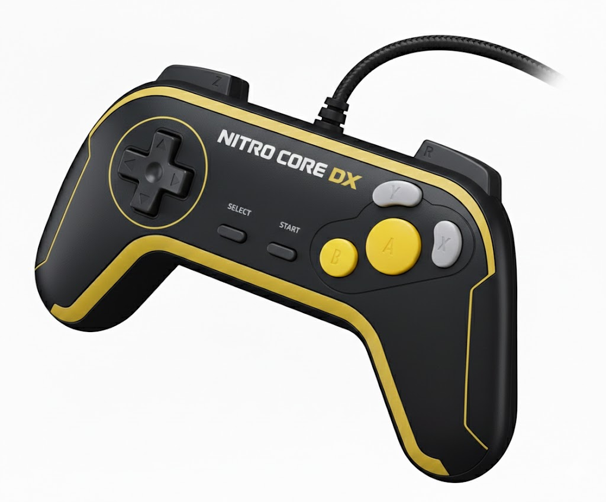

# Nitro-Core-DX

**A 16-bit fantasy console with SNES-style graphics, Genesis-style speed, Yamaha FM sound, CoreLX, and its own Dev Kit.**

Nitro-Core-DX is a custom fantasy console inspired by the best ideas of the 8/16-bit era: layered tile graphics, Mode 7-style perspective tricks, hardware sprites, fast DMA-driven rendering, Yamaha FM synthesis, and tight cartridge-era constraints. It is not just an emulator. The project includes the console model, a compiled high-level language called CoreLX, an integrated development app, asset tools, an assembler, and a pack-in demo used to prove the whole stack.

> **Active Development:** the core console architecture is stable. The CoreLX overworld builds and runs in the Dev Kit. Current work is YM2608 conformance and editor/debugger polish.

---

## Meet Nitro-Core-DX

Picture the console ad you wish ran in a 1994 game magazine: big parallax, fast sprites, crunchy FM bass, weird pseudo-3D tricks, and a name that sounds like it should be printed in chrome.

That is the spirit of Nitro-Core-DX. What if you took SNES-style graphics, Genesis-style speed and DMA, Yamaha FM sound, and built a new console around them? Think of it as the machine from an alternate timeline where Nintendo and Sega collaborated instead of competing. I am not trying to recreate history. I am trying to create the console that should have existed.

The project is built from the ground up with modern tooling, but it keeps the good parts of classic console development: a clear hardware model, fast frame-based thinking, direct control over graphics and audio, and a real cartridge workflow.

---

## The Vision: Best of Both Worlds

### What I'm Stealing (Politely) from SNES

The SNES influence is mostly visual:

- **Four background layers** for parallax, HUDs, status panels, and scene composition
- **Matrix Mode** for Mode 7-style perspective and rotation across four independently usable matrix-capable layers
- **RGB555 color** with a 256-color indexed display palette
- **Hardware sprites** with priorities, blending, alpha, and native sizes from 8×8 up to 128×128
- **Banked memory concepts** for a cartridge-oriented programming model

### What I'm Taking from Genesis

The Genesis side is about speed, DMA, and sound. Its faster CPU budget and DMA-heavy feel made arcade-style games move with a snap, and its Yamaha YM2612 gave the console a sharp FM identity. Nitro-Core-DX takes that energy and pairs it with the YM2608/OPNA, a bigger Yamaha FM chip with FM, SSG, rhythm, and ADPCM capabilities.

That gives Nitro its Genesis influence: responsive 16-bit pacing, practical graphics transfers, Yamaha FM character, richer chip resources, and a music pipeline built around compact `.ncdxmusic` streams.

### The Result

A fantasy console with SNES-style visuals, Genesis-style speed, Yamaha FM audio, smooth 60 FPS targets, advanced parallax scrolling, and four Matrix Mode-capable background layers for perspective effects, racing-style scenes, and pseudo-3D landscapes.

---

## What Makes It Different

Nitro-Core-DX is becoming a complete game-making platform, not just a ROM runner.

- **The console/emulator** models the CPU, memory map, PPU, YM2608 audio path, input, ROM loading, and frame stepping.
- **CoreLX** is the compiled high-level language for writing Nitro games without dropping all the way to assembly.
- **The Dev Kit** is the integrated app for editing, building, running, debugging, and authoring assets.
- **Sprite Lab and Tilemap Lab** cover visual asset creation and project insertion.
- **Sound Studio** imports VGM/VGZ, opens `.ncdxmusic`, previews it in the emulator, and adds the song to the project.
- **Assembler v1** remains available for lower-level workflows.

The important idea is that all of these pieces are meant to meet in the same place: build a project, run it on the emulator, validate it against the hardware model, and eventually package it like a real console game.

---

## Why Go?

Nitro-Core-DX is written in Go because it gives the project compiled native binaries, solid performance for a 60 FPS emulator loop, readable systems code, and straightforward cross-platform builds. Memory safety is a useful bonus, but the real reason is practical: the code needs to be fast enough to run the console well and simple enough to keep improving.

---

## CoreLX

CoreLX is the compiled, Lua-like language for Nitro-Core-DX. It is designed for hardware-first game programming: you can write approachable code while still thinking in frames, sprites, backgrounds, memory, input, and audio.

The practical v1 surface is in place: modules, structs, arrays, block scope, `else if`, hardware builtins, image and music assets, and programs that span ROM banks. The CoreLX overworld builds and runs, and the test suite checks its frames.

The language rules are in the [CoreLX Programming Manual](CORELX_PROGRAMMING_MANUAL.md). If that book and the compiler disagree, trust the compiler and its tests.

---

## The Dev Kit

The Nitro-Core-DX App is the integrated development environment for the console.

Current user-facing pieces include:

- CoreLX editor
- Build and Build + Run workflow
- Embedded emulator pane
- Sprite Lab for sprite art
- Tilemap Lab for map editing
- Project templates
- ROM loading for direct `.rom` testing

Sound Studio is in the Dev Kit: Import VGM/VGZ, open `.ncdxmusic`, preview in the embedded emulator, and Add to project.

See the [Nitro-Core-DX Manual](NITRO_CORE_DX_MANUAL.md) for the full Dev Kit user guide.

---

## Current Showcase: NitroPackInDemo

The proving ground for Nitro is **NitroPackInDemo**.

NitroPackInDemo is the pack-in game: a pseudo-3D overworld, a building you can enter, an interior, NPC dialogue, and credits. The picture is the CoreLX build of that game.


The runnable showcase is the CoreLX rebuild, `Games/NitroPackInDemo/corelx/overworld.corelx`. It covers the same slice: a matrix-plane floor, the building, the player sprite and HUD, collision and doors, the interior, dialogue, credits, and reset. Open that file in the Dev Kit and press **Build + Run**.

To play a cartridge you already built, open the player and use **File → Open ROM…**:

```bash
go run ./cmd/emulator
```

The older ROM-first demo is still in `Games/NitroPackInDemo` for the pre-CoreLX build. The picture above, and the game you should run, is the CoreLX one.

More detail lives in [NitroPackInDemo README](Games/NitroPackInDemo/README.md) and [NitroPackInDemo design](Games/NitroPackInDemo/DESIGN.md).

---

## Console Design

<div align="center">


*Isometric view of the Nitro-Core-DX console*


*Top-down view showing the console design*



*The Nitro-Core-DX controller design*

</div>

---

## System Specifications

| Feature | Specification |
|---------|---------------|
| **Display Resolution** | 320×200 pixels (landscape) / 200×320 (portrait) |
| **Color Depth** | 256 colors (8-bit indexed) |
| **Color Palette** | 256-color CGRAM, RGB555 format, 32,768 possible colors |
| **Background Layers** | 4 independent layers: BG0, BG1, BG2, BG3 |
| **Matrix Mode** | Four matrix-capable background layers with per-layer transforms, HDMA updates, outside-screen handling, and direct color |
| **Sprites** | 128 hardware sprites |
| **Sprite Sizes** | 8×8, 16×16, 32×16, 32×32, 64×32, 64×64, 128×64, 128×128 |
| **Tile Size** | 8×8 or 16×16 pixels, configurable per layer |
| **Audio** | YM2608/OPNA audio subsystem: FM, SSG, rhythm, ADPCM |
| **Audio Sample Rate** | 44,100 Hz |
| **CPU Speed** | ~7.67 MHz, 127,820 cycles per frame at 60 FPS |
| **Memory** | 64KB per bank, 256 banks, 16MB total address space |
| **ROM Size** | 4,096,000 bytes (125 banks × 32KB). The file is 32 bytes larger than that. |
| **Frame Rate** | Target: 60 FPS; current desktop emulator build holds steady 60 FPS in the tested baseline |

The full hardware description — CPU, memory map, PPU, YM2608, I/O, timing, cartridge header — is in the [Nitro-Core-DX Manual](NITRO_CORE_DX_MANUAL.md), Part 2.

---

## Project Status

### Implemented

- Core CPU, memory, PPU, input, ROM loading, frame stepping, and assembler workflows.
- Four-layer graphics, Matrix Mode, DMA/HDMA, sprites, priorities, blending, and larger sprite sizes.
- YM2608 runtime audio, `.ncdxmusic` stream playback, and CoreLX `music.*` playback.
- Major CoreLX v1 language/runtime surface needed for current demo and tooling work.
- Dev Kit Build/Run, embedded emulator, diagnostics, Sprite Lab, Tilemap Lab, and Sound Studio.

### In Progress

- YM2608 conformance against the chip.
- Editor and debugger polish in the Dev Kit.

### Roadmap

- **Now:** the CoreLX overworld builds and runs. The Dev Kit is how you open a project and play it. Both manuals match that.
- **Next:** YM2608 conformance, and editor/debugger polish.

Historical milestone notes live under [docs/archive/planning](docs/archive/planning/).

---

## Quick Start

### Download a Release

Prebuilt packages are published on GitHub:

- [Releases](https://github.com/RetroCodeRamen/Nitro-Core-DX/releases)
- [Latest release](https://github.com/RetroCodeRamen/Nitro-Core-DX/releases/latest)

Package names:

- Linux: `nitrocoredx-<version>-linux-amd64.tar.gz`
- Windows: `nitrocoredx-<version>-windows-amd64.zip`

After extracting:

- Linux: run `./nitrocoredx`
- Windows: run `nitrocoredx.exe`

Release packages include this README. The Dev Kit binary inside is `nitrocoredx` (Linux) / `nitrocoredx.exe` (Windows).

### Build from Source

Prerequisites:

- Go 1.22 or later
- SDL2 development libraries

Install SDL2:

```bash
# Ubuntu/Debian
sudo apt-get install libsdl2-dev

# Fedora/RHEL
sudo dnf install SDL2-devel

# macOS
brew install sdl2
```

Clone and run the integrated Dev Kit:

```bash
git clone https://github.com/RetroCodeRamen/Nitro-Core-DX.git
cd Nitro-Core-DX
go run ./cmd/corelx_devkit
```

The player is a separate window. It opens with no cartridge; use **File → Open ROM…** for a `.rom` or `.cart`. `-rom` loads one as the window opens.

```bash
go run ./cmd/emulator
go run ./cmd/emulator -rom path/to/game.cart
```

Do not use `go build ./...` as the default project build; it sweeps vendored reference code under `Resources/` that needs C libraries this project does not depend on. Build the Dev Kit or the emulator as above. Longer source-build notes are in the [Nitro-Core-DX Manual](NITRO_CORE_DX_MANUAL.md), §16.

---

## Using the Dev Kit

The normal workflow is:

1. Create a project from a template or open an existing `.corelx`, `.ncdx`, `.cart`, or `.rom`.
2. Edit CoreLX in the integrated editor.
3. Click **Build + Run**.
4. Test the result in the embedded emulator.
5. Use Sprite Lab and Tilemap Lab to create or update visual assets.

Use **Load ROM** when you want to run a prebuilt `.rom` without recompiling. Check **Capture Input** on the emulator pane when testing controls.

---

## Developer Notes

For emulator flags, the keyboard map, and the Dev Kit debugger, see the [Nitro-Core-DX Manual](NITRO_CORE_DX_MANUAL.md). Test ROM generators live under `test/roms/`.

---

## Documentation

Two books:

- [Nitro-Core-DX Manual](NITRO_CORE_DX_MANUAL.md) — playing the console, the hardware, the Dev Kit
- [CoreLX Programming Manual](CORELX_PROGRAMMING_MANUAL.md) — the language, the builtins, and how studio assets land in source

The [documentation index](docs/README.md) points at those two plus the demo programs in `docs/manual_examples/`. Everything else is history under [docs/archive](docs/archive/).

---

## Project Structure

```text
Nitro-Core-DX/
├── cmd/                    # User-facing tools: emulator, CoreLX compiler, Dev Kit, importers, assembler
├── internal/               # Emulator, compiler, PPU/APU/CPU, Dev Kit services, debug support
├── Games/                  # First-party game/demo projects, including NitroPackInDemo
├── roms/                   # Active runnable ROM artifacts
├── test/                   # Test ROMs, sample programs, and validation helpers
├── docs/                   # Specs, planning docs, guides, testing docs, archive
├── Images/                 # Console/controller images
└── Resources/              # External/reference resources and visual assets
```

Important root docs: `NITRO_CORE_DX_MANUAL.md`, `CORELX_PROGRAMMING_MANUAL.md`, `CHANGELOG.md`, and this README.

---

## Contributing

Contributions are welcome. The best starting point is the current documentation map and roadmap:

1. Read the two manuals and [docs/README.md](docs/README.md).
2. Run the relevant tests before opening a PR.
3. Use `go fmt` for Go changes.
4. Keep README changes high-level; put user-facing detail in the manuals.

---

## License

This project is licensed under the MIT License. See [LICENSE](LICENSE) for details.

---

## Acknowledgments

- **SNES**: for showing how much personality layered 16-bit graphics can carry
- **Sega Genesis**: for the speed, DMA-heavy feel, and Yamaha FM sound lineage that helped define 16-bit games
- **The retro game development community**: for keeping old hardware ideas alive and worth remixing
